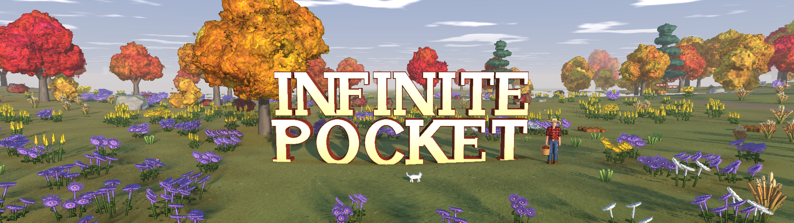
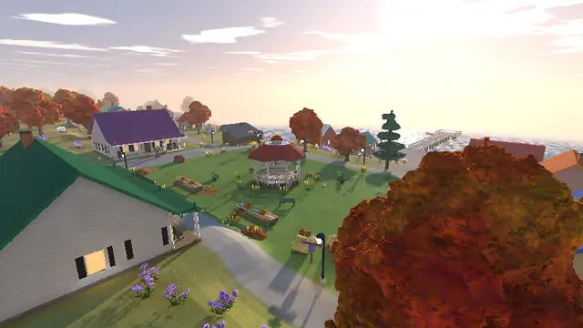
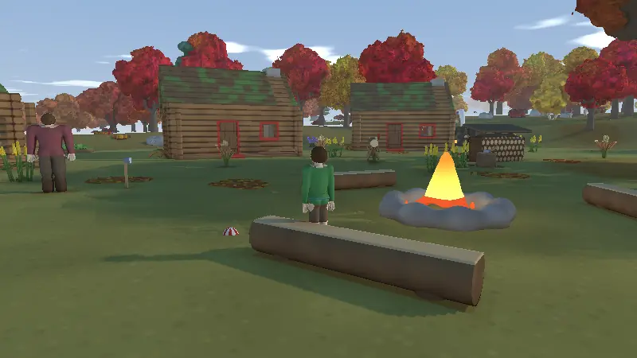
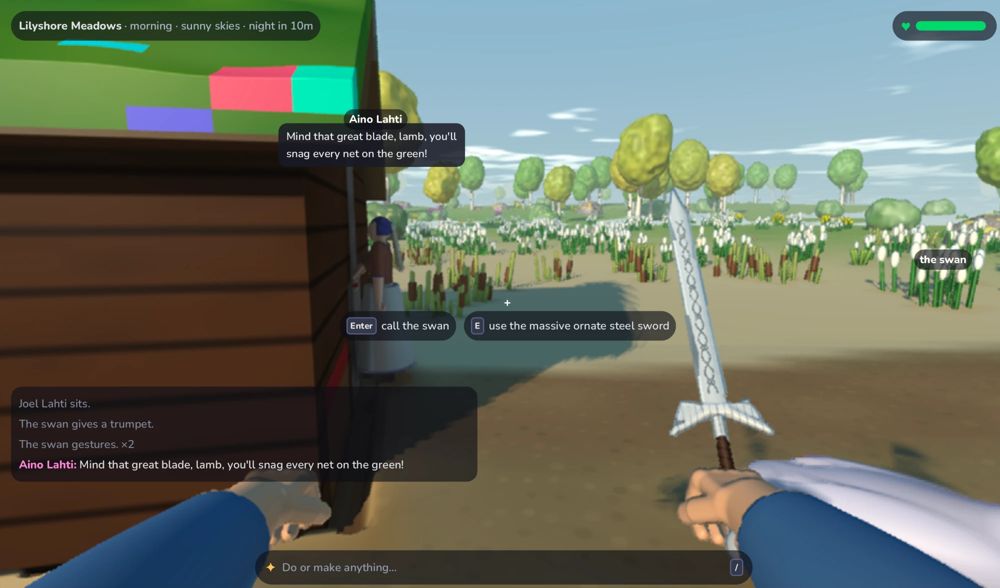
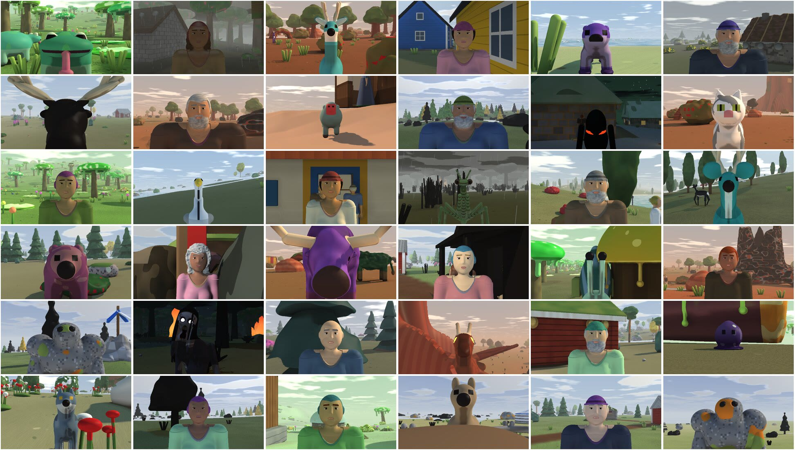

# Infinite Pocket

**Infinite Pocket is a creative game powered by an AI harness for creating and interacting with 3D digital worlds.** 



Type what you want and it's there: `/a lighthouse on that hill`, `/a griffin that lets me ride it`, `/rub the stone on the lantern`. The AI writes it as code, on the spot, and it becomes part of the world for good.

The people in it remember you. They have homes, needs, friends and plans. They gossip, carry logs together, play catch, and make things of their own. Dogs fetch, goats bolt from wolves, fire spreads through dry grass and stops at a green tree. At night something comes for you.



Then invite a friend into your world and build it together.

## Install (Mac with Apple Silicon)

```bash
brew install viktoo/tap/pocket
```

```bash
pocket
```

Then add an Anthropic API key in **Settings → AI**. Get one at [platform.claude.com](https://platform.claude.com/settings/keys).

Windows is coming.

## Play


|                        |                                                  |
| ---------------------- | ------------------------------------------------ |
| `W` `A` `S` `D`, mouse | walk and look (click the view to grab the mouse) |
| `Enter`                | talk to whoever is in front of you               |
| `/`                    | make or do anything, in words                    |
| `e` `g` `f`            | use, pick up, throw                              |
| `Esc`                  | pause, settings, play together                   |



## Multiplayer

Host a world and your friends join it, on the same network or over the internet with ngrok. See [Multiplayer](docs/multiplayer.md).

## Build worlds with a coding agent

Everything in the game is code the AI can read and write, and the game can check its own work. `pocket` takes screenshots, records clips, describes what's in view, and runs a world headless, so a coding agent (Claude Code, Codex, Cursor…) can build a place, look at it, and fix it:

```bash
pocket snapshot my.pocket --at 0,0,90 --time 17       # a view from anywhere
pocket my.pocket --shot out.png --after 8             # a real frame of the game
pocket describe my.pocket --at 0,0,90                 # what's in view, as JSON
pocket sim my.pocket --hours 24                       # run a day and see what happened
pocket record my.pocket --at 0,0,90 --to 20,0,90 --out clip --webp   # a clip of the world going on
```

An agent can look at anyone it made, in front of their own home. Here are 36 people and creatures from 13 generated worlds (`pocket snapshot my.pocket --face ID --open`):



The [full guide](docs/guide.md) has every command, setting and how it all works.

## Build from source

```bash
brew install cmake
```

```bash
curl --proto '=https' --tlsv1.2 -sSf https://sh.rustup.rs | sh
```

```bash
cargo install --locked --git https://github.com/Viktoo/infinite-pocket
```

Tests and releases: [docs/guide.md](docs/guide.md#tests), [docs/releases.md](docs/releases.md).