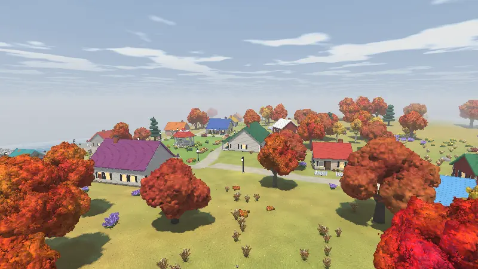
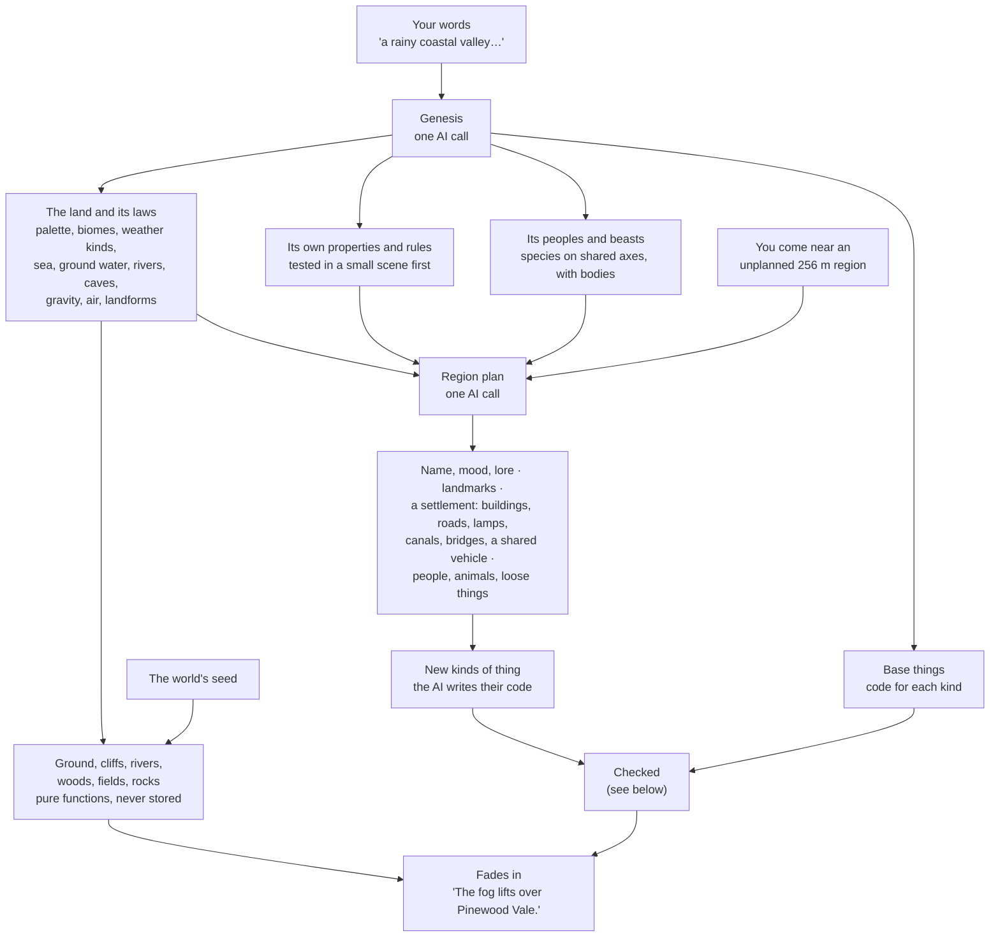
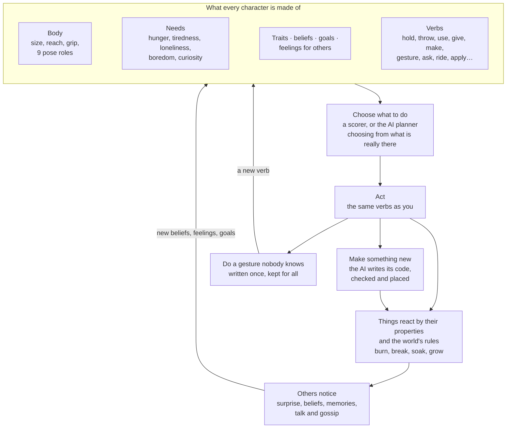
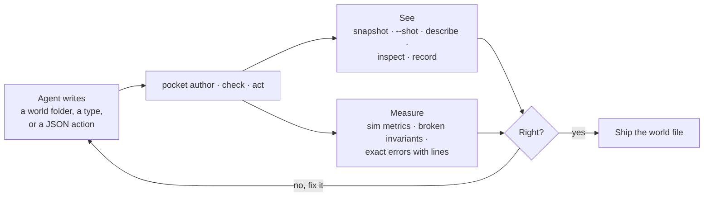
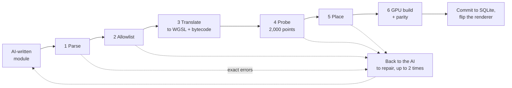

# Infinite Pocket: the full guide

**Infinite Pocket is a 3D world that you change by typing.** You walk around, talk
to the people who live there, and type what you want. An AI writes it
as code on the spot, the game checks that code, and it becomes part of the world for
good.

The world keeps going whether you watch or not. People have homes, trades, needs,
friends and plans. They make things for their own reasons, play catch, carry logs
together, gossip, and remember what you did. Fire spreads through dry grass and
stops at water. At night something comes for you.

**For players** it's a place where anything you can describe can happen. **For
developers and coding agents** it's a world built entirely from small parts that an
AI fills in, and one that can check its own work. Every view, every thing and every
mind can be read back as text, numbers, pictures or clips, so an agent can build a
place, look at it, measure it and fix it with no person in the loop.

| You can | How |
|---|---|
| Walk, run, swim, ride, climb ladders, drive a cart or a boat | keys and mouse ([Playing](#playing)) |
| Talk to anyone, by typing or by speaking | `Enter` when you face them |
| Make or do anything, in words | `/` and a sentence |
| Pick up, use, throw, wear, give | `g` `e` `f`, `/wear`, `/give NAME` |
| Play with friends in one world | **Esc → Open to friends** ([multiplayer](multiplayer.md)) |
| Share a world as one file | **Your worlds → S** |
| Build and test worlds from a script or an agent | `pocket author`, `pocket sim`, `--shot` ([Tools](#tools-for-agents-and-scripts)) |

**Contents:** [Quick start](#quick-start) · [Playing](#playing) ·
[How a world is made](#how-a-world-is-made) · [How a world comes alive](#how-a-world-comes-alive) ·
[Settings](#settings-and-environment) · [Tools for agents](#tools-for-agents-and-scripts) ·
[How it works](#how-it-works) · [Tests](#tests) · [Limitations](#limitations) · [More docs](#more-docs)

---

## Quick start

```bash
brew install viktoo/tap/pocket
```

```bash
pocket
```

You start in **Maple Cove**, an autumn village that ships with the game, ready to
play. To make new things, talk to people or make new worlds, add an Anthropic API key
(or any OpenAI-compatible endpoint) in **Settings → AI**.

```bash
pocket                     # the title: Continue, Worlds, Play together, Settings, Quit
pocket FILE                # straight into a world
pocket list                # start on your worlds
pocket new "a rainy coastal valley where the lighthouse keeper vanished"   # a new world from these words
pocket new --difficulty hard                                               # a random real place, on hard
pocket host [FILE]         # open a world to friends (see docs/multiplayer.md)
pocket join ADDRESS CODE   # join one
pocket version             # this build
```

A new world with no words gets a random one: a plain, real place or era from
`src/builtin/places.txt` (no fantasy; anything strange comes from play).
`pocket prompts --sample 50` prints some.

**Build from source.** Rust (stable), `cmake` (for the speech recogniser), and a GPU
with Metal, Vulkan or DirectX 12. Without a GPU the game falls back to a slower CPU
renderer and says so at the top right.

```bash
cargo build --release      # → target/release/pocket
```

---

## Playing

Everything happens in one window, with buttons you can click or work with `↑` `↓`
`Enter` `Esc`. Click the view to look with the mouse; it lets go when a menu or typing
opens. `Cmd+V` pastes. `Cmd+Q`, or closing the window, saves and quits.

### Keys

| Key | What it does |
|---|---|
| `W` `S` / `A` `D` | walk / step sideways |
| mouse, or `←` `→` `↑` `↓` | look around |
| `Shift` + move, or `r` to keep it on | run |
| `Space` / `c` | jump / crouch (to get under something low). Swimming or on a flyer: up / down |
| `Enter` | talk to who is in front of you (within 4 m). An animal answers with a noise and its body |
| `/` | do or make anything, in words |
| `e` | use what you hold on what you point at: open a door; swing, chop, dig or pour with a tool; shoot a bow or a gun and load it from ammunition you point at; light something that goes off; pet, ride, greet or feed who is in front; get into a cart. With empty hands, picks up |
| `g` | pick up / put down (small animals too, if they let you) |
| `f` | throw (sharp things fly point first) |
| `y` / `n` | answer someone's question |
| `1` | the journal: everything said and done. `Tab` filters it, `PgUp` `PgDn` scroll |
| `Esc` or `F10` | pause menu |
| `F1` / `F2` / `F3` | frame stats / the raw truth about what you point at / achievements |
| `F5` | (playing together) copy the invite |

You point with the small `+` in the middle of the view. Under it you see the name of
what you look at and the keys that act on it (`Enter talk to Mara`, `E pet`). Tips
that teach keys show the first few times only.

### What's on screen


Top left: where you are, the time of day, the weather and when night comes. Top
right: your health. Over people and animals: their names, and what they say. Under
the `+`: the keys for what you point at (here, call the swan, or use the sword you
hold). Bottom left: the feed of recent talk and deeds, fading after a while. At the
bottom: the bar to type into.
Others show when they happen: what the AI is still making, an achievement, and
how many are stirring nearby or elsewhere.

### Typing to the world

Whatever you type after `/` goes to the world. It reads your words together with
what you point at and what you hold, and decides whether to change that thing or
make something new: `/punch a hole here`, `/add the stick to this wall`,
`/make it rain`, `/conjure a hound`.

| Command | |
|---|---|
| `/undo`, `/history` | undo the last thing you made; list the world's versions |
| `/day`, `/night`, `/morning`, `/dusk`, `/time HOUR` | move the clock forward |
| `/help`, `/inspect` | the list of commands; the raw-truth view (`F2`) |
| `/wave` `/bow` `/nod` `/cheer` `/dance` `/sit` | gestures |
| `/hug NAME` `/kiss NAME` `/handshake NAME` `/highfive NAME` | contact gestures: the other one decides by how they feel about you |
| `/gesture ANY [NAME]` | any gesture. One nobody knows yet (`/gesture salute`) is written once by the AI as key poses and kept, so anyone can do it after |
| `/give NAME`, `/say TEXT`, `/drop` | hand over what you hold; say something out loud; put it down |
| `/propose NAME catch\|carry\|dance\|walk\|…` | start something together |
| `/ride NAME`, `/drive`, `/dismount`, `/pet NAME` | ride a mount, drive the vehicle in view, get off |
| `/wear` (what you hold), `/takeoff` | put on, take off |
| `/invite`, `/name NAME`, `/kick NAME` | playing together |

Shortcuts count only in exactly this form. `/wave the flag` is something you do, in
words. Ask someone for something in talk and they may really do it: make it and hand
it to you, show the way, follow you. Talking needs an AI key (a guest uses the host's).

With **Speak to talk** on (Settings → Sound, off by default), `/` or `Enter` opens
the mic and your words fill the line as you speak. Nothing is sent until you press
`Enter`. Speech is recognised on your machine.

### Menus

- **Pause** (`Esc`): Back to game, Achievements, Creations, World options, Settings,
  Open to friends, Save and quit to title, Quit game.
- **World options**: difficulty, how fast lives go, the most of one kind of creature,
  whether hunters kill their prey, whether deeds can bring new beings, and what the AI
  has cost.
- **Creations**: everything made in this world since it began, who made it, from
  what, and whether it's still here (`here · 40 m north` or `gone`). `Tab` groups by
  kind, by maker, or newest.
- **Journal** (`1`): filters for all, talk, notable, life, made, and elsewhere (what
  changed beyond earshot, with where: `✧ … (Khar Mod Heights, 240 m north)`).

### Day and night

Days pass, and light, lamps and windows follow the hour.



### Night and difficulty

Every world has a difficulty. New worlds start on normal. On peaceful nothing comes;
on the others the dark comes for you every night, because you can make things out of
nothing.

| | Peaceful | Easy | Normal | Hard |
|---|---|---|---|---|
| night walkers | 0 | 1 | 2 | 3 |
| phantoms | 0 | 1 | 2 | 3 |

- **Night walkers** come out of the dark behind you at nightfall. They move only
  while you aren't looking straight at them, wait at the edge of any light, and are
  gone at dawn. A touch takes a quarter of your health. You can strike them down.
- **Phantoms** are characters with one drive: to hurt you, and anyone else they come
  upon. They pick up weapons, put on armour, make one thing a night, plan their hunt
  with the AI, and ignore light. Struck down, they rise the next night. At dawn each
  writes down what it learned, so they come back better armed and smarter.
- **Health** is the bar at the top right. Blows take it, less what you wear protects
  (a thing's `protect`). Falls from higher than one and a half times your height hurt
  (12% per metre beyond it). Deeds in words can hurt (`/kick the wolf`). It mends over a day.
- **Falling.** At no health you drop where you stand and **YOU DIED** shows over the
  world, which goes on. Whoever saw it remembers. `Enter` wakes you at the start, in
  the morning, whole. What you held stays where you fell.

Any species can keep night hours, shun light, move only unseen or mean harm. These
are a few fields on the species (`active`, `shuns`, `moves_unseen`, `hostile`,
`drive`), so the night uses the same parts as the rest of the world.

### Weather, sound and voices

- **Weather** is written per world when it is made: a few kinds (fair days, drizzle,
  sea fog, a storm; ash fall or glimmer rain in stranger worlds) that come and go.
  Rain wets things and puts fires out. Most people get out of it, a frog folk goes out
  in it. `/make it rain` changes it for a while. See [weather.md](weather.md).
- **Sound** is made live from small recipes, with no audio files, and heard from where
  you stand and face: a call behind you is dull, turn to it and it is clearer, walk up
  and it is louder. Footsteps follow each body's weight and the ground. Species sound
  as their `voice` says. See [sound.md](sound.md).
- **Voices.** People speak their lines aloud, each in a voice of their own, made on
  your machine (nothing is sent anywhere). See [voices.md](voices.md).

### Saving, sharing, playing together

- A world is one `.pocket` file (SQLite) that saves all the time, including what people
  are in the middle of. Worlds live in `~/.pocket/universes/` (or `POCKET_HOME`); the
  log is `~/.pocket/pocket.log`. Copy a file to fork a world.
- **Share:** on **Your worlds**, choose a world, press `S`, then `Enter`. That makes one
  clean `.pocket` file in Downloads. To play one you were sent, drop it on the game
  window. A copy keeps the land, what was made, the people and their memories. It
  leaves out your health, your things (put down where you stood), your place, and what
  the world cost. API keys are never in a world file.
- **Together:** **Esc → Open to friends**, on the same network or anywhere through
  ngrok. Friends don't need a key; the host sets how much each guest may spend. See
  [multiplayer.md](multiplayer.md).
- A world records the build that made it (`made_with`) and the one that last opened
  it (`last_opened_with`), for when an old world acts oddly in a newer build.

---

## How a world is made

The engine knows no houses, swords, dogs or canals. It knows a few kinds of
**primitive**, small parts with fixed rules, and the AI fills them in for each
world. A lighthouse is a shape plus a colour plus some properties. A dog is a body
plus a few numbers. A canal is a ground edit along a line. Because everything is made
of the same parts, anything new the AI writes works with everything already there.

| Primitive | What the engine knows | What the AI writes | Example |
|---|---|---|---|
| **Shape** | signed distance and colour, checked and compiled to the GPU | a small code module per kind of thing | a lighthouse, a cloak, a dragon's body |
| **Properties** | 27 built in (`mass`, `burns`, `wet`, `light`, `edible`, `fragile`, `toy`, …) | values per thing; new properties per world | an oil lantern: `burns 0.6, light 1, fragile 0.7` |
| **Rules** | data: what a property does to what is near | a world's own rules, tested before use | heat ignites what burns; a curse spreads by touch |
| **Behaviour** | `tick`, `use`, `touch` on a tiny, safe VM | code per kind of thing | an acorn on the ground becomes a sapling |
| **Anchors** | doorways, seats, shelves, stairs, ladders, light | where they sit on a shape | a house with a door that opens and a bed inside |
| **Tools** | how a thing is held and worked | grip and action | a sword swings, an axe fells a tree, a spade digs |
| **Bodies** | 9 pose roles, look sliders, reach, grip, seat | a body shape that answers to the roles | a dragon's hug is its wings wrapping |
| **Species** | shared axes: size, mind, speech, diet, social, temper, moves | numbers on those axes | wolves hunt what is smaller; goats herd |
| **Ground edits** | cut, raise, flatten along a line or area | the edits a settlement makes | canals, terraces, a harbour, a moat |
| **Gestures** | key poses on the roles | new gestures, once each | `/gesture salute`, a naga's own cheer |

The same bodies and species, filled in by the AI, give every world its own people
and creatures. Here are 36 from 13 generated worlds, each in front of their own home:
herders and ferrywomen, a rust-ox, a stilt mantis, stone elders of the steppe, slime
creatures, and a night walker and a phantom by night (`pocket snapshot FILE --face ID --open`).


### From your words to a world



1. **Genesis.** One call when the world is made. It writes the world's look and laws,
   any properties and rules of its own (a curse that spreads by touch, tested in a
   small scene and rejected if it blows up), its species, and its base kinds of thing.
   It also splits your words into the whole **land** and where you **start**, so a
   one-village prompt doesn't repeat in every region.
2. **The ground** comes from the seed: rolling land blended across biomes, cliffs in
   hilly ones, landforms where the prompt names real ones (a bay, a range), rivers,
   caves, and things that gather as in nature (woods with clearings, flower fields of
   one colour, boulder fields). It is never stored. It exists twice, in Rust and in
   the GPU shader, and tests keep the two within 1e-3. See [terrain.md](terrain.md).
3. **Regions** (256 m square) are planned as you approach, two regions ahead by
   default. Each plan gives a name, mood, lore, landmarks, at most one settlement, up
   to six people with homes, trades, looks, aims and relationships, animals, and the
   small things people use. A settlement shapes its land (canals cut, terraces built,
   streets laid), and gets roads between its doors, lamps, walkways, a bridge or a
   shared vehicle. See [ways.md](ways.md) and [levels.md](levels.md).
4. **Every new kind of thing** goes through the same checks before it appears.
5. **The loading screen** waits until genesis and every region within about 110 m are
   done, so you never step into a world that isn't there yet.

A hand-made world goes the same way: `pocket author DIR` answers each of those calls
from files instead of the AI ([Tools](#tools-for-agents-and-scripts)). Maple Cove was
made like this (`worlds/starter`).

---

## How a world comes alive

Every person and animal is built from the same few primitives: a **body**, **needs**,
**traits**, **beliefs**, **goals**, **feelings** for others, and a shared set of
**verbs**. You, the characters and a test agent all act through those same verbs.
Nothing is scripted. What happens comes from these parts meeting each other, the
world's rules, and the AI's ability to write new things and new actions on the spot.



**An afternoon nobody wrote** (each step is a test in `src/sim/tests`):

1. Nothing has been made nearby for a minute, so the idlest person turns to their
   trade. A bored one makes a ball from what lies around, and it ends up thrown at a
   hoop.
2. Two people who like each other play catch: a throw plus a catch, both verbs
   everyone has. Two others carry a log too heavy for one.
3. Someone drops a lantern. It breaks (`fragile`), spills burning oil (a rule), the
   grass catches (`burns`), and the fire reaches a hut. It stops at the water.
4. That's one **incident**, with one cause. Neighbours push back: nobody tells them
   how. Each imagines working what is at hand against the fire by the world's rules,
   and takes what works best (hands beat out flames).
5. Whoever saw it start knows who dropped the lantern. Whoever only saw the flames
   reach them guesses. Gossip passes those beliefs on, a little less sure each hop, so
   rumours arise without anyone lying.
6. Trust shifts. New goals follow: mend the hut, avoid the careless neighbour.

The same parts make animals behave without new code. A meat eater hunts what is
clearly smaller than it and its pack, never its kin or the traveler. Prey keeps its
distance, herds run together, pets follow their person and fetch. Elves and orcs
who start out cold warm to each other one shared game at a time. Families have young,
and a line that people keep feeding gets tamer until it is named as a variety of its
own.

---

## Settings and environment

Settings are in **Esc → Settings** (or from the title), saved in
`~/.pocket/settings.json`. World options are saved with the world. An environment
variable wins for its run.

| Tab | What's there |
|---|---|
| Video | **Quality** (Auto, or Lowest … Very high, Sharpest), **View distance**, Smooth edges, Shadows, Frame rate cap |
| Sound | Sound, Volume, Voices, Voice volume, Speak to talk (microphone) |
| AI | your key or another endpoint, the model for each job, budget per session |
| Together | your name, what each guest may spend |
| General | key prompts and tips, news of new versions |
| Controls | the keys |

**Quality.** The world is drawn at fewer lines than the window has and scaled up.
Auto (the default) keeps to the frame-rate cap, raising detail while the GPU keeps up.
Smooth edges blends each frame with the last ones, so detail builds up while you stand
still and nothing smears as you move. On an M5 Pro a 360-line frame takes 6–12 ms in
a village or forest.

**Models.** On the Claude API: `claude-opus-5-5` builds (genesis, regions, code) and
plays characters; `claude-haiku-5-5` makes fast decisions and summaries. The running
cost shows in the pause menu, and every call is recorded in the `llm_usage` table.

| Variable | Meaning |
|---|---|
| `ANTHROPIC_API_KEY` | use the Claude API |
| `ANTHROPIC_WORKSPACE_ID` | workspace for user-scoped keys (`sk-ant-usr-…`) |
| `POCKET_LLM_BASE_URL`, `POCKET_LLM_API_KEY` | any OpenAI-compatible endpoint (Ollama, LM Studio, vLLM…), e.g. `http://localhost:11434/v1` |
| `POCKET_MODEL` | the model for every job; or per job: `POCKET_MODEL_BUILDER`, `_CHARACTER`, `_DECIDER`, `_SUMMARIZER` |
| `POCKET_PRICE_IN`, `POCKET_PRICE_OUT` | $ per million tokens, for models the built-in table doesn't know |
| `POCKET_BUDGET_USD` | pause making and talk at this much spent this session; walking keeps working |
| `POCKET_REGION_RADIUS` | how many regions ahead to plan (default 2) |
| `POCKET_DECIDER_URL` | an external decision model: receives the event JSON, returns `{"action", "line"}` |
| `POCKET_HOME` | where worlds, settings and the log live (default `~/.pocket`) |
| `POCKET_FPS` | frame-rate cap (default 60) |
| `POCKET_WINDOW_DETAIL` | fix the lines drawn, e.g. `360` |
| `POCKET_NO_GPU`, `POCKET_NO_TAA`, `POCKET_NO_VSYNC`, `POCKET_NO_SHADOWS` | CPU renderer; no frame blending; no vsync (to see the peak); no shadows |
| `POCKET_NO_SOUND`, `POCKET_NO_VOICE`, `POCKET_NO_MIC` | no sound; no voices; no speaking to talk |
| `POCKET_NAME`, `POCKET_HOST_CODE` | your name when playing together; the code `pocket host` gives out |

**How alive the world is.** Every limit below can also be set per world in its `kv`
table as `sim.<name>`, which wins over the variable.

| Variable | Default | Meaning |
|---|---|---|
| `POCKET_SIM_NEAR` | 220 m | full simulation within this distance of you |
| `POCKET_SIM_MEDIUM`, `POCKET_SIM_MEDIUM_HZ` | 512 m, 2 | reduced-rate simulation up to here, ticks per second |
| `POCKET_SIM_FAR` | `frozen` | or `catchup:HOURS`: when you come back, run the missed time quickly on rules alone |
| `POCKET_LLM_PER_MIN` | 12 | AI decisions per real minute for the whole world, nearest characters first |
| `POCKET_SIM_PLAN_SECS`, `POCKET_SIM_SIMPLE_PLAN_SECS`, `POCKET_SIM_QUEUE_WAIT` | 60, 300, 20 | how often a person / an animal may ask the planner (game s); how long a request may wait (real s) |
| `POCKET_SIM_MAKER_SECS` | 60 | near you, someone makes something at least this often (0: off) |
| `POCKET_SIM_WORK_SECS`, `POCKET_SIM_WORK_GAP` | 600, 120 | one person works at their craft at most this often; anyone in the world, at most this often |
| `POCKET_SIM_MAX_LOOSE` | 20 | past this many loose things around a maker, new work uses some up |
| `POCKET_DIFFICULTY` | — | 0 peaceful … 3 hard, for worlds with none set |
| `POCKET_SIM_HUNTING` | 1 | 0: predators only chase, then give up |
| `POCKET_SIM_CREATE_BEINGS` | 1 | 0: deeds can't bring new beings (`/conjure a hound`) |
| `POCKET_SIM_TRANSFORM` | 0 | 1: beings can be turned into other species even without a world's own forces |
| `POCKET_SIM_OWN_BODIES` | 1 | species on a shared template body get their own body written |
| `POCKET_SIM_LIFE_SPEED` | 1 | births and growing up (0 stops births) |
| `POCKET_SIM_MAX_CREATURES` | 24 | how many of one kind a region holds before births stop |
| `POCKET_SIM_BELIEFS` | 200 | beliefs each mind keeps (the least worth keeping fade first) |
| `POCKET_SIM_MAX_BURNING` | 250 | while this many things burn, fire reaches nothing new |
| `POCKET_SIM_MAX_AWAKE`, `_MAX_FLAMES`, `_MAX_THINGS`, `_CHAT_RANGE`, `_RULES_HZ`, `_BEHAVIOR_HZ`, `_MEDIUM_LLM` | 300, 48, 5000, 20 m, 4, 4, on | further limits |

---

## Tools for agents and scripts

Andrej Karpathy [pointed out](https://x.com/karpathy/status/2083749667410727319)
(August 2026) that a model which builds a 3D world has a hard time checking its own
work. It has to take screenshots one slow step at a time, and it can't watch video or
play. **Infinite Pocket is built so that doesn't happen.** Every part of the world
answers back in a form a model can read: a frame as text or a PNG, what's in view as
JSON, the full state of a thing or a mind, a day of life as numbers, a clip of motion,
exact errors with line numbers. The checks that guard the game guard the agent too.

That gives a loop that can run unattended. An agent writes, the game checks, and the
agent reads the result and writes again, as many times as it takes. The game already
runs this loop inside itself: every piece of AI-written code is checked and sent back
with exact errors for repair before it can appear.



| To | Command |
|---|---|
| **Build** a world from hand-written files | `pocket author DIR [--out FILE]` |
| Check one kind of thing's code | `pocket check my_type.js` |
| Read the ground's heights to place things | `pocket author heights FILE x0,z0,x1,z1 STEP` |
| **See** one frame as text | `pocket snapshot FILE --at 0,0,90 [--size 120x40] [--time 21] [--weather storm] [--face ID]` |
| See any real screen as a PNG, with its words in `out.txt` | `pocket FILE --shot out.png [--size 1600x1000] [--after 8] [--keys esc,down]` |
| List what is in view, as JSON | `pocket describe FILE --at 0,0,90` |
| Read the raw truth about anything | `pocket inspect FILE player\|npc:3\|thing:12\|instance:7\|cell:10,20\|NAME` (or `--look`) |
| Watch motion as a clip | `pocket record FILE --at 0,0,90 [--to 20,0,90 \| --follow ID] --seconds 8 --out DIR [--webp] [--speed 100 --loop 30]` |
| **Act** as anyone | `pocket act FILE --as Mara '{"do": "hold", "target": {"name": "stick"}}'`, or `--stdin` for one command per line |
| **Measure** a day of life | `pocket sim FILE --hours 24 --seed 5 [--events out.jsonl] [--no-llm] [--save]` |
| Read a run back / check it replays | `pocket sim --replay out.jsonl --kinds ignited,caught` / `pocket sim FILE --hours 3 --verify` |
| Hear it | `pocket listen --demo --out DIR`, `pocket listen FILE --species wolf`, `pocket listen FILE --at 0,0,90 --walk --calls` |
| Measure speed | `pocket bench FILE`, `pocket gpubench FILE --at 0,0,90 [--breakdown] [--ab 32 --shots DIR]`, `pocket selftest` |

`pocket help` lists every flag. All of these work on a private copy unless told to
save (`--shot` plays the world, so give it a copy).

- **`pocket author DIR`** runs the ordinary generation with files answering in the
  AI's place: `world.json` (seed, prompt, spawn, regions), `genesis.json` and
  `base/*.js`, `regions/RX_RZ.md` (each region's plan), `types/NAME.js` (each new
  kind). Every type is checked, every dropped placement reported, and the build fails
  if anything is missing. The result is a clean world file, ready to ship.
- **`--shot`** works on any screen. It runs the game unseen, presses keys one per frame
  a second before the end (`--keys down,down,enter` works menus), and saves the window
  as a PNG plus everything it says as text.
- **`pocket record`** runs the world as in play and saves frames, then a clip with
  ffmpeg (mp4, or `--webp` / `--gif`). The camera stands, moves in a line (`--at` to
  `--to`, with `--lift` and `--pitch`), or follows someone. `--speed` makes a
  time-lapse (a whole day is 1200 game seconds), and `--loop N` fades the end into the
  start. You are kept 45 m behind the camera, out of the way. The README's clips in
  `docs/clips` were made like this.
- **`pocket sim`** prints what emerged: events by kind, things made per hour, how far
  things travelled, the longest chain of cause and effect, how often people talk about
  things, how much feelings changed, and broken invariants. If these stay flat, nothing
  is emerging.

**Actions** (for `pocket act`, the AI planner and the game alike) are JSON with a
`do` field: `move`, `turn`, `goto`, `hold`, `drop`, `place`, `throw`, `use`, `eat`,
`do`, `create`, `say`, `gesture`, `propose`, `answer`, `give`, `wear`, `take_off`,
`ride`, `pet`, `dismount`, `follow`, `wait`, `wait_until`, `sleep`, `wake`,
`go_home`, `flee`, `ask`, `plea`, `apply`, `resume`, `open`, `jump`, `crouch`.
Targets are `{"thing": ID}`, `{"actor": "player" | ID}`, `{"instance": ID}`,
`{"cell": [X, Z]}`, `{"point": [X, Y, Z]}` or `{"name": "ball"}` (the nearest match).

---

## How it works

### Threads

| Thread | Does |
|---|---|
| main | window events, the sim tick, culling, compositing, presenting (one draw per frame) |
| render | the GPU device: a raymarch compute pass into a buffer, read back through 3 buffers |
| tokio runtime | AI calls (streamed), job orchestration |
| worker pool | parse, allowlist, translate, probe |
| committer | placement checks, shader builds, GPU parity, SQLite commit, the flip |

### Code the AI writes, and how it is checked

Every kind of thing is a small module in a strict subset of JavaScript:

```js
export const meta = { name: "lighthouse", bounds: [3, 14, 3], tags: ["building", "landmark"] };
export function sdf(x, y, z, k) {
  const tower = cappedCone(x, y - 6, z, 6, 1.6, 1.0);
  const lamp  = sphere(x, y - 12.5, z, 1.1);
  return smoothUnion(tower, lamp, 0.3);
}
export function color(x, y, z, k) {
  if (y > 11.5) return rgb(255, 230, 160);
  return (floor(y / 2) % 2 == 0) ? rgb(220, 60, 50) : rgb(240, 240, 235);
}
```

It is never run as JavaScript. It goes through six checks, and only code that passes
all of them reaches the world:



1. **Parse** (oxc), with line numbers.
2. **Allowlist.** Every node is checked while lowering to a typed IR. Anything not
   allowed is rejected: `while`, open-ended `for`, recursion, helper functions,
   closures, `new`, `this`, `import`, strings outside `meta`, unknown names.
3. **Translate** to WGSL for the GPU and to a verified register bytecode with a fuel
   limit for the CPU.
4. **Probe** on the CPU at 2,000 points: finite values, valid colour, fuel under
   budget, not empty, inside its bounds. Behaviour code is run through typical
   situations too.
5. **Place**: on the ground, not floating, not overlapping you, characters, the start
   point or other things.
6. **GPU build** (validated by naga, compiled in the background) and a check that GPU
   and CPU agree.

A frame and the world version it draws always travel together, so a frame never sees
a half-applied change, and `/undo` is instant. The language reference the AI sees is
in `src/prompts.rs`.

A module can also say what a thing is made of and what it does on its own:

```js
export const meta = { name: "oil lantern", bounds: [0.12, 0.2, 0.12], tags: ["item", "light"],
  props: { mass: 1.2, light: 1, heat: 150, fragile: 0.7, burns: 0.6, fuel: 0.5 },
  says: ["The flame steadies."], sounds: ["clink"], spawns: ["ash"] };
export function tick(s, w, k) { s.s0 += w.dt; if (w.water > 0) { w.light = 0; sound(0); } }
export function use(s, w, k, o) { s.s1 = 1 - s.s1; if (w.on > 0) { o.temp += 100; } }
export function touch(s, w, k) { if (w.impact > 6) { w.health -= 0.5; } }
```

Behaviour runs on the bytecode VM with a fuel limit. It changes 8 state slots
(`s.s0`…`s.s7`, which the shape reads as `k.s0`…`k.s7`, so a door can open or a
fruit ripen) and properties (`w.<prop>`, and `o.<prop>` for what it is used on), and
queues effects (`say`, `sound`, `spawn`, `transform`, `remove`) that the world applies
with caps. Property names must be ones the world knows.

Shapes say more with `meta`: `anchors` (doorways, seats, shelves, stairs), `tool` (how
it is held and worked), `body` (for beings), `drive` (vehicles), `in_ground` (set into
the earth). See [physics.md](physics.md) and [levels.md](levels.md).

### Drawing

- **Rendering** (`src/shaders/*.wgsl`, `src/render/`). One GPU thread per pixel
  raymarches the land and the visible things. The CPU culls things by distance and
  view and uploads them. Above 64 visible things an 8 m grid is built, and each ray
  walks it to collect only the shapes it crosses. Distant land is read from a
  camera-centred heightmap (512², rebuilt on the GPU every 24 m), near land from a fine
  one (12.5 cm cells). Sun and moon with soft shadows, sky light, ambient occlusion,
  fog, stars, water with reflections, animated flames and up to 8 point lights at
  night. One game day is 20 real minutes.
- **Screen** (`src/term.rs`, `src/window/`). Every screen draws into a grid of text
  cells plus soft shapes (panels, pills, keycaps) and free text over it. The window
  scales the world frame up, then draws cells, shapes and words (titles in Fraunces,
  the rest in Nunito, both OFL, in `assets/fonts`). Without a window (tests,
  `pocket snapshot`) the same grid is written as terminal text.

### The living world (`src/sim/`)

One `Sim` holds everything that changes: actors (you and the characters, with the
same kind of body), live things, rules and minds. It runs in the game, headless in
`pocket sim`, and under `pocket act`.

| Distance from you | What runs |
|---|---|
| up to 220 m | everything, every frame |
| up to 512 m | characters at 2 ticks a second, still able to ask the AI |
| beyond | frozen, or caught up on rules alone when you return |

**Things**

- *Live layer.* Most of the world is fixed and versioned. A thing joins the live layer
  when it is touched, thrown, lit or has behaviour. Live things save continuously.
- *Toy physics.* Gravity (per world), bounce, friction, buoyancy. Things are spheres
  against the ground and the shapes of nearby solids, so a ball bounces off any shape
  the AI wrote. Things at rest sleep. Bodies stand on floors, stairs and roofs, step up
  what is lower than their step, and are stopped by what is too small for them, so the
  same house is a home to a person and closed to a giant. See [physics.md](physics.md).
- *Properties and rules* (`props.rs`, `rules.rs`). Each property's entry says its units
  and anchors ("an apple 0.2, a person 70"), when a change is news ("caught fire"),
  whether it spreads, and how harmful it is. Fire is one entry, not code. Rules run a
  few times a second on live things and what is next to something happening: heat
  warms, flames ignite what burns, fire eats fuel and chars, water soaks and douses,
  living things grow. Burnt and eaten plants grow back after a day or so.
- *Checked words.* A near-miss property name ("curse" in a world of `cursed`) is
  mapped once and kept; a name nothing maps to is sent back to be fixed. Act properties
  (`force`) are set only by the engine.
- *Bodies* (`body.rs`) have properties like things: warm unless their species says
  otherwise. A world's rules reach people too: a curse spreads to whoever holds the
  idol, a kiln warms those beside it. You are never in the rules.
- *Incidents* (`incident.rs`). Many changes with one cause are one incident: a fire
  that eats 300 tufts started at one lantern thrown by someone. The log has one line
  per incident, updated as it grows.
- *The interpreter* (`interp.rs`). When an action falls outside the rules and the
  things' own code, the AI decides, but must answer as property changes, state, new
  things and removals. Answers are cached by who, what, with what and on what, so the
  same cause gives the same effect. Your `/` makes things outright; characters follow
  the world's laws.

**Minds**

- *Choosing* (`scorer.rs`, `npc.rs`). One scorer decides every body's free moments,
  people's and animals' alike. The world offers things to do (food, toys, new things to
  see, company weighted by feeling, home, trouble, the next step of a goal). Each is
  scored by one formula (need × relief × how much their nature cares, minus cost), and
  one is drawn from the world's seeded numbers, so a seed replays the same day. With an
  AI the planner is the main brain: it hears the best options as a menu of what is
  really there and may choose anything. Between its turns, or with no AI, the scorer
  decides.
- *Needs* (`needs.rs`). When a deed can't be done as things are, the interpreter names
  one need: a place, a thing, someone, or a time. The character uses what is there,
  waits, makes it, or asks up to three people in turn.
- *Goals* (`goals.rs`). Rows with an owner, what they want (a condition the sim checks
  where it can, words otherwise), why, a deadline, and who it was promised to. A goal
  met is remembered and a promisee trusts them more; a goal given up costs trust.
- *Beliefs* (`beliefs.rs`). What each one holds true, how they know (saw, guessed,
  told), how sure, and when. Gossip passes beliefs on a little less sure each hop.
  Only those who mean harm lie.
- *Surprise* (`surprise.rs`). One number for how much something breaks what an
  onlooker thinks can happen. It sets how much they remember and retell it, and whether
  they drop what they are doing.
- *Life together* (`social.rs`). Affection, trust, rivalry, family and partners,
  seeded from who people are and changed by what they do. Shared activities are made
  from primitives: catch is throw plus catch, carrying a log is two holds on something
  too heavy for one, a hug is a gesture both agree to.
- *Memory* (`src/brain.rs`). Every exchange is stored. Talk is built from the world,
  the person, a rolling summary, the most relevant memories, what the region knows, and
  what is around right now.

**Species and bodies** (`src/world/species.rs`, `beings.rs`, `motion.rs`, `life.rs`;
more in [species.md](species.md))

- A species is a body plus numbers: size, mind (`instinct`, `simple`, `sapient`),
  speech (`none`, `sounds`, `words`), diet, social (`solitary` … `village`), temper,
  speeds (walk, run, fly, swim), water and caves, sleep hours, need rates. Built in:
  people, dogs, cats, horses, wolves, goats and deer. Worlds add more.
- A body has nine pose roles instead of limbs (`raise_l/r`, `reach_l/r`, `lean`,
  `head`, `crouch`, `spread`, `grip`), and each body gives them its own meaning, so every
  gesture plays on every body. One that needs parts a body lacks is written once for
  that species (`cheer@naga`).
- Looks are sliders chosen per being. Clothes and gear are layers drawn in the body's
  pose, and they are live things: a cloak burns, armour slows you.
- Riding puts one body in another's seat; the mount must be much bigger and agree.
  Flyers cruise over the land. Deeds in words can dress, feed, teach or (in a world
  with its own forces) turn a being into another species, memories kept.

### Storage (`src/db.rs`)

One SQLite file: `universe`, `versions`, `types`, `instances`, `regions`,
`characters`, `memories`, `summaries`, `player`, `llm_usage`, `kv`, and the live
world: `things`, `cells`, `spent_cells`, `relationships`, `vocab`, `rules`, `goals`,
`beliefs`, `interp_cache`, `events` (the latest 5,000) and `origins` (who made what).
Only the AI-written source is stored; GPU code and bytecode are rebuilt on load.
Opening an older world adds what is new.

---

## Tests

```bash
cargo test                                    # after every edit: ~350 tests, ~4 s (debug build)
cargo test sim::tests::night                  # just the part you touched
cargo test --release --features slow-tests    # before merging: adds a village day, a fought fire, wolf generations, a crowd at speed
cargo test --release -- --ignored --nocapture # by hand: a 1.5 km walk with live generation, rendered pictures
```

The debug build rebuilds in seconds and is optimised enough to test with. Long
scenarios sit behind `slow-tests`; anything that only prints or writes pictures is
`#[ignore]`. Keep new tests lean: simulate only as long as the point needs, and don't
run the world twice to check determinism (`same_seed_same_history` does that for all).
Tests that need the AI use a scripted model in-process, with no network.

What is proven, and where:

| Claim | Test |
|---|---|
| You enter only once the world around you exists | `app::loading::tests` |
| Generation never blocks drawing or input; a 2 km walk without a frame over 50 ms | `app::tests::long_walk_with_generation_has_no_hitches` (ignored, long), `pocket bench` |
| Malicious code is rejected at the allowlist; broken code is repaired or rejected | `lang::tests::malicious_fixtures_rejected_at_allowlist`, `fixtures/broken/*`, `e2e_tests` |
| GPU and CPU agree within 1e-3 | `render::tests::gpu_parity_types_and_terrain`, `cliffs_agree_on_gpu_and_cpu`, `pocket selftest` |
| Atomic flip, exact and instant undo; `/a lighthouse on that hill` while walking | `e2e_tests`, `app::tests::talk_create_undo_via_keys` |
| A character remembers you after a restart; a copied file diverges on its own | `e2e_tests` |
| Same seed, same history; the agent drives you and a character through the same calls | `sim::tests::same_seed_same_history`, `agent_drives_player_and_character_the_same_way` |
| A thrown stone bounces off an AI-made lighthouse and comes to rest | `sim::tests::thrown_stone_bounces_off_a_lighthouse_and_sleeps` |
| A dropped lantern starts a fire that reaches a hut and stops at water; a firebreak holds | `sim::tests::dropped_lantern_starts_a_fire_that_spreads_to_a_hut_and_stops_at_water`, `a_firebreak_wider_than_the_heat_reach_stops_fire` |
| A world's own spreading curse works; explosive rules are rejected | `sim::tests::universe_rules_spread_cursed_and_explosive_rules_are_rejected` |
| An acorn becomes a sapling and grows | `sim::tests::an_acorn_on_the_ground_becomes_a_sapling_and_grows` |
| The interpreter decides once, then the cache does | `sim::tests::interpreter_lights_the_lantern_and_caches_the_answer` |
| A deed that needs a place, a thing nobody has, a later hour | `sim::tests::a_deed_that_needs_a_place_is_done_there`, `a_need_nobody_has_is_asked_for_in_turn`, `a_deed_for_a_later_hour_waits_for_it` |
| Unscripted: a bored character makes a ball; it is thrown through a hoop | `sim::tests::a_made_ball_ends_up_thrown_at_a_hoop`, `a_ball_thrown_at_a_hoop_goes_through` |
| Catch, carrying a log together, a hug, a refused kiss | `sim::tests::people_play_catch_carry_together_and_hug` |
| A dog plays the same gestures with its own body; follows and fetches; a wary cat keeps away | `sim::tests::a_dog_plays_the_same_gestures_with_its_own_body`, `a_dog_follows_and_fetches_and_a_wary_cat_keeps_its_distance` |
| Wolves chase goats, never people; elves and orcs warm by playing | `sim::tests::wolves_chase_a_herd_and_peoples_warm_to_each_other` |
| AI-written species live, hug and learn their own gestures | `sim::tests::llm_written_species_live_hug_and_learn_their_own_gestures` |
| Armour worn, a cloak burns and plate doesn't; giants and a small traveler | `sim::tests::a_warrior_village_wears_its_armour_and_giants_dwarf_the_traveler` |
| Dressing needs consent; feeding, teaching, a curse into a toad, conjuring | `sim::tests::deeds_dress_feed_teach_curse_and_conjure_beings` |
| Species get their own bodies; one being can be reshaped | `sim::tests::species_get_own_bodies_and_one_being_can_be_reshaped` |
| Griffins fly, horses carry and bolt | `sim::tests::griffins_fly_horses_carry_and_bolt` |
| Young are born and grow; a fed wolf line turns tame and gets a name | `sim::tests::families_grow_and_a_fed_wolf_line_turns_tame` |
| 1,000 things and 50 people at over 10× real time | `sim::tests::a_thousand_things_and_fifty_people_run_fast` |
| A village left for two game days has changed; the world survives a restart | `sim::tests::a_village_left_for_two_days_has_changed`, `live_things_cells_and_relationships_persist` |
| A call behind you is dull; turned to, clearer; walked up to, louder | `audio::mix::tests::behind_then_facing_then_walking_up_gets_louder_and_clearer` |
| Sound is heard where it happens; listening changes nothing; a busy night is cheap | `sim::tests::noises_bumps_and_impacts_are_heard_where_they_happen`, `listening_changes_nothing`, `audio::mix::tests::a_dense_night_runs_faster_than_real_time` |

---

## Limitations

- Physics is deliberately a toy: spheres against shapes, no stacking or joints.
- The ground is a heightfield with caves cut into it: no overhangs or arches. Nobody
  climbs a rock face; the way up is round it, a gully, or a ladder.
- Water has levels but doesn't flow: a full basin doesn't spill, rain doesn't fill
  hollows, and water is the only liquid.
- Bodies are one shape each with nine pose roles; gestures are stylised. Nothing is
  smaller than a cat (at low detail it would be a pixel). Layers can't change what a
  body can do (wings on a saddle).
- Characters plan routes through one building's doors and stairs at a time; land
  vehicles drive straight rather than along roads.
- Story regions that fail to generate are retried next session, not in the same one.
- Hearing and seeing don't count floors and rock between (someone in a cave hears the
  street above).
- Most AI paths are tested with a scripted model. Tune the prompts in `src/prompts.rs`
  against a real one with `pocket sim FILE --hours 1`.

## More docs

| Doc | About |
|---|---|
| [physics.md](physics.md) | bodies, rooms, doors, tools, carrying, vehicles, things that fly and go off |
| [ways.md](ways.md) | ground edits, canals, bridges, rivers, water levels, caves |
| [levels.md](levels.md) | homes dug into the ground, hatches, ladders, tree platforms, walkways |
| [terrain.md](terrain.md) | cliffs, fields and woods, landforms |
| [species.md](species.md) | species, bodies and lives |
| [voices.md](voices.md) | character voices and speaking to talk |
| [sound.md](sound.md), [weather.md](weather.md) | sound and weather |
| [multiplayer.md](multiplayer.md) | playing together, step by step |
| [releases.md](releases.md) | release numbers, Homebrew, updates |
