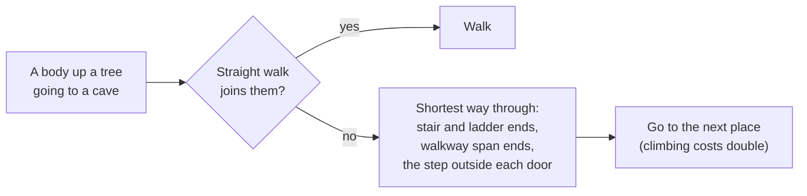

# Under the ground and up off it

**This is how homes are dug into the earth or set up in the trees**, reached by
ladders, hatches and walkways, with caves that have life of their own. None of it
knows what an elf, a dwarf hold or a tree-house is. The AI writes the shapes; the
engine reads a few fields on them.

```
            tree platform ═══ walkway (rope, timber, stone) ═══ tree platform
                 ║ ladder                                           │
   ──────────────╨──────── ground ────────┬──[hatch]──────────────┴──────────
     earth house ╲  ramp to its door      │ ladder                ╭────────╮
     (lawn on the roof) ╲________[door]   │                       │  cave  │ fungus,
                                     home under the hatch         ╰────────╯ cave crickets
```

| To get | A shape says | Section |
|---|---|---|
| a home set into the earth | `meta.in_ground: depth` | [Set into the ground](#set-into-the-ground-metain_ground-srcingroundrs) |
| a door of any style, a hatch | a `door` or `hatch` anchor, with `holds` | [Doors and hatches](#doors-and-hatches-of-any-style) |
| a ladder | a `stairs` anchor steeper than 1.3 | [Ladders](#ladders-srcsimclimbrs) |
| something up in a tree or on stilts | a placement `height` | [Up off the ground](#up-off-the-ground-on-a-support) |
| a walkway between platforms | `settlement.walkways` | [Walkways](#walkways-built-in-walkway) |
| plants and beasts of the caves | `meta.grows: { at: "cave" }`, a species' `"caves": true` | [Life in caves](#life-in-caves) |

---

## Set into the ground (`meta.in_ground`, `src/inground.rs`)

`in_ground: depth` on a shape says it is set into the earth. The earth is cleared
**exactly from its solid's box** as a box-shaped hollow, and stays round it and over
its roof. A cliff dwelling keeps the cliff over it; an earth house keeps the lawn on
its roof.

- **Where it stands** (`inground::seat`): its floor `depth` metres under the ground
  just outside its doorway. With a `depth` under 1 (a doorway that opens onto the
  surface), it is turned to the open side of a hill if the plan faced it into the
  earth. A hatch sits level with the ground.
- **Its way in** (`inground::cave`): each doorway gets an opening through the earth;
  a doorway under the ground gets a ramp dug up to the surface (1:2); a hatch gets a
  shaft through any earth over it. The cave's mouth is the top of the ramp, the step
  outside the door, or the hatch.
- The hollows are their own cave layer, rebuilt with every world version. Bodies,
  falling things, the renderers and the planner all read them as caves (see
  [ways.md](ways.md)).
- People going in walk to the mouth, down the ramp and through the door; coming out,
  the other way round (`rooms::route`). On a stair, people go on to the end nearer
  where they are going.

The plain cut under any building with a doorway runs out to its walls and slopes in
from them, so the ground meets the walls with no ring of air.

---

## Doors and hatches of any style

- A `door` anchor may name its own door in `holds`: a type on a hinge (a round door,
  an iron gate, a stone slab, a hide flap) hung in the doorway instead of the plain
  wooden one. If no type of that name exists, the region builder writes it, sized to
  the doorway.
- A `hatch` anchor (`size: [width, depth]`) is an opening in a floor, a roof or the
  ground. A lid is laid in it, hinged along its back edge: its own (`holds`) or the
  built-in `hatch`. It opens with `e`, like anything with `meta.joint`.
- A room ends at its shape's real roof, so someone standing on a roof hatch is outside
  it.

---

## Ladders (`src/sim/climb.rs`)

A `stairs` anchor steeper than 1.3 (rise over run) is a ladder: rungs, a rope ladder,
pegs up a trunk. Its `at` is the floor in front of its foot; its `to` is the floor it
reaches, a step past its top.

- You go up by walking into its foot, and down by walking off its top toward it (or
  looking down while walking). Anyone falling past a ladder catches hold.
- On it, a body is held (no falling) and moves along it; at either end it steps off.
- A shut hatch over the top stops a climber: people open it; you wait under it until
  you press `e`.
- People take a ladder when their way goes up or down it.

---

## Up off the ground on a support

A placement with a `height` that would float is set on whatever placed thing stands
under it within reach (`WorldModel::support_below`): a platform in a great tree, a
ledge, stilts, a roof, placed earlier. With nothing under it, it is refused, with the
reason. Region plans give buildings, landmarks and things a `"height"`.

---

## Walkways (built-in `walkway`)

```json
"walkways": [{ "from": [dx, dz, height], "to": [dx, dz, height], "width": 1.2, "look": "rope" }]
```

`look` is `rope`, `timber` or `stone`. Each end rests on what stands there at that
height, or on the ground at height 0; a walkway with nothing under an end is left
out. It is laid in straight spans of up to 14 m (shorter where it climbs, up to 7.5 m
of climb a span), and a rope bridge sags in the middle (`settle::spans`). Its shape is
exact on a gentle slope, so a body walks straight onto it.

---

## Finding the way between levels (`src/sim/levels.rs`)



Two places at one level (within 0.6 m) are joined where something holds a body up all
the way between them; places on the ground are all joined. A way is remembered for
1.5 s. A body on the ground going somewhere on the ground needs none of this.

---

## Life in caves

- `meta.grows: { at: "cave" }`: it grows only on cave floors, as thick as the biome
  above says for its tag, where there is room under the roof. Not in the rooms of
  shapes set into the ground.
- A species with `"caves": true` has its home in the nearest cave's chamber, starts on
  a cave floor, and wanders only over cave floors.
- People and creatures keep the height they were saved at, so someone up a tree or
  down a cave is still there after a load.

---

## Tests

| Test | Covers |
|---|---|
| `inground::tests` | the solid box, turning to a hill's open side, a ramp to a door under flat ground |
| `sim::tests::underground` | an earth house a villager walks into and out of; a hatch home: hung, opened, the ladder down and up; you held under a shut hatch until it opens; fungus on a cave floor and a cave cricket that keeps to the cave |
| `sim::tests::heights` | a hut on a tree platform, a walkway between two platforms, a villager climbing, crossing, going in and coming down |

Pictures, by hand: `POCKET_PNG_DIR=… cargo test --release earth_house_png -- --ignored`
(also `tree_village_png`).

---

## Not done

- Not yet tried at length with a real AI.
- Walkways are the built-in span only; a plan can't give its own span type.
- Ladder climbing is kinematic: a climber passes through what lies between its foot and
  top (a roof's edge by a hatch).
- A ramp dug to a door under the ground is a round tunnel, not a trench with straight
  walls or steps.
- A shape set into the ground doesn't take the ground water.
- Routing between levels joins places up to 30 m apart only, so a way along a long
  platform with no turn on it may not be found. It is fine for a village and untried
  with crowds.
