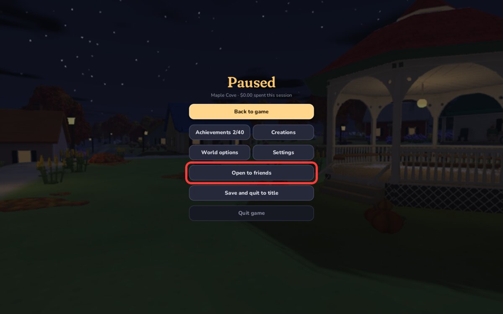
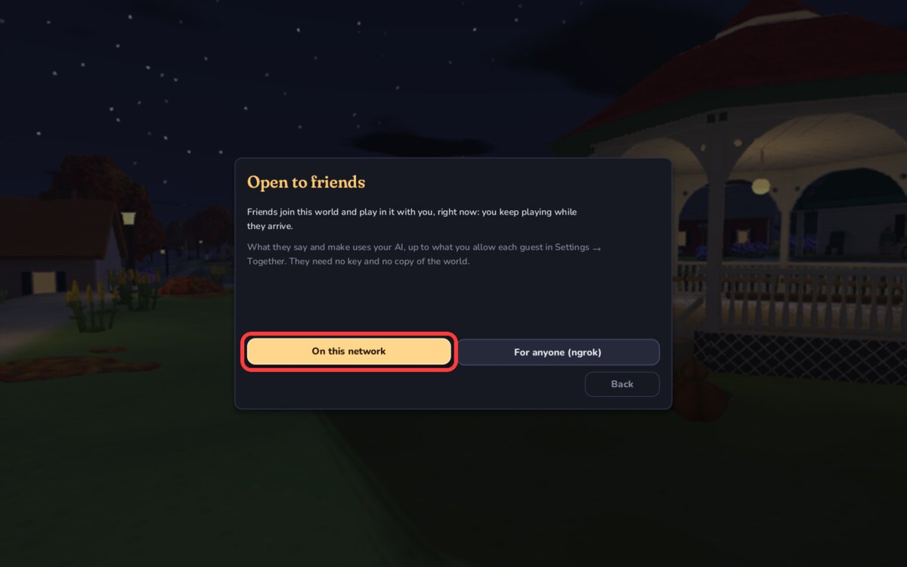
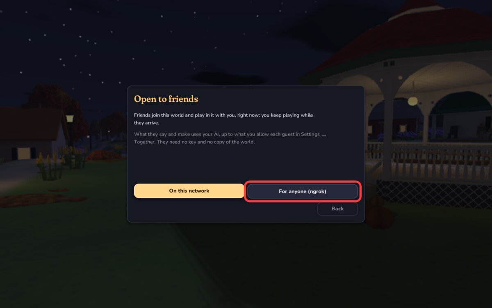
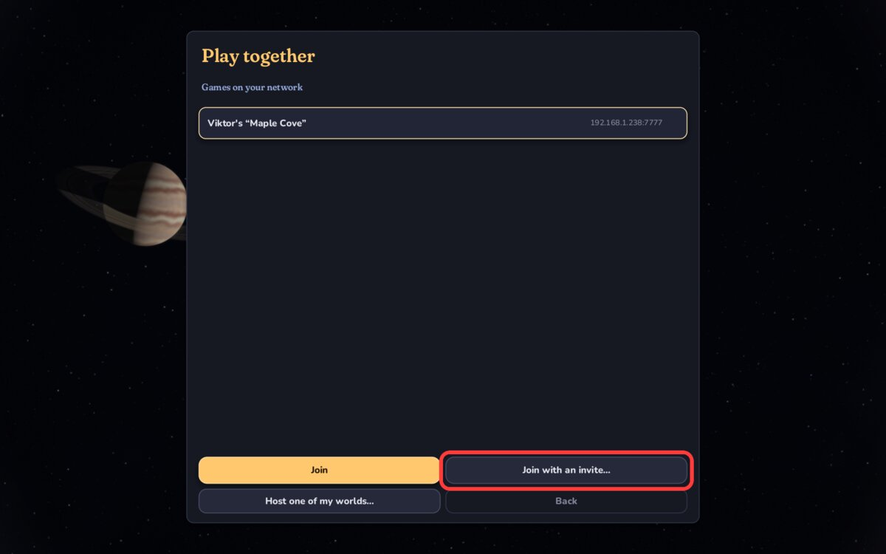
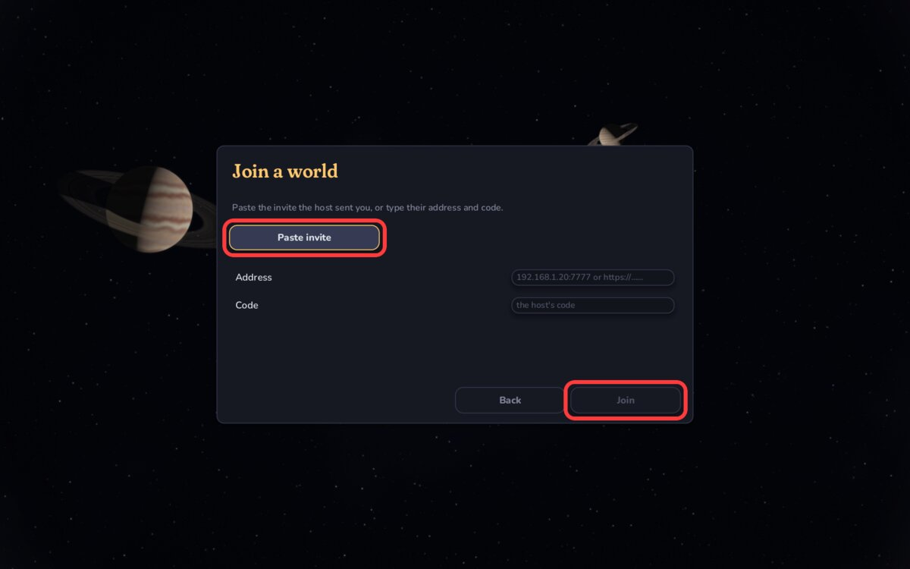

# Multiplayer

One person hosts and friends join. Friends don't need an AI key. Everyone needs the same version of the game.

## Same Wi-Fi

**Host**

1. In your world, press `Esc` and click **Open to friends**.

   

2. Click **On this network**.

   

3. Tell your friends the code shown on the next page.

**Friend**

1. On the title screen, click **Play together**.

2. Pick the host's game, click **Join**, and type the code.

## Over the internet (ngrok)

**Host**

1. Install ngrok and sign in once. Your token is on [dashboard.ngrok.com](https://dashboard.ngrok.com).

   ```bash
   brew install ngrok
   ```

   ```bash
   ngrok config add-authtoken YOUR_TOKEN
   ```

2. In your world, press `Esc`, click **Open to friends**, then **For anyone (ngrok)**.

   

3. Click **Copy invite** and send it to your friends.

**Friend**

1. On the title screen, click **Play together**, then **Join with an invite…**

   

2. Click **Paste invite**, then **Join**.

   
