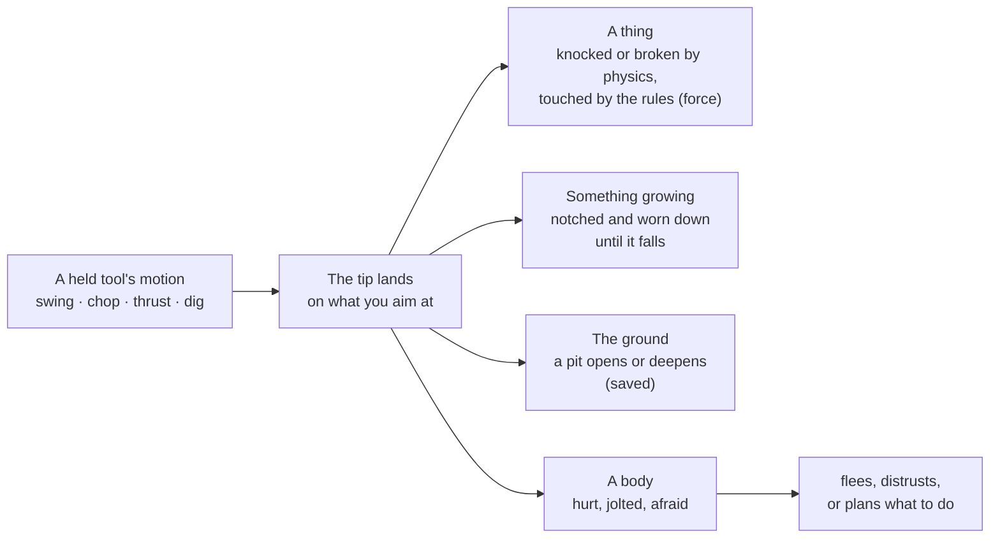

# Bodies, things and tools

**This is how bodies move, how things are used, and what happens when something
hits something.** The engine knows no houses, swords, carts or guns. It knows a few
fields that any shape can carry: where its doorways and seats are, how it is held,
whether it can be driven, whether it goes off. The AI fills them in for each world,
and everything it writes works with everything else.

| A shape can say | Field | Example |
|---|---|---|
| where things go on it | `meta.anchors` | a doorway, a seat, a bed, stairs, a shelf holding a sword |
| it swings on a hinge | `meta.joint` | a door, a gate, a lid |
| how it is held and worked | `meta.tool` | a sword swings, an axe chops, a spade digs, a bow shoots |
| it can be driven | `meta.drive` | a cart, a boat, a flying carpet |
| it goes off | `meta.burst` | a firework, a powder keg, dynamite |
| it takes the ground away under it | `meta.hollow`, `meta.in_ground` | a cellar, a burrow, a house dug into a hill ([levels.md](levels.md)) |

The field definitions are in `src/lang/ir.rs`; the language reference the AI sees is
in `src/prompts.rs`.

---

## Bodies (`sim/footing.rs`, `world/collide.rs`)

Every body (you, characters, animals, mounts) is an upright capsule sized by its own
body: a radius, a height, and a step of a quarter of its height.

| | |
|---|---|
| **Standing** | on the highest support under it: the ground, or the top of any solid below its step (a floor, a stair, a roof, a rock). It steps down stairs, falls off ledges, lands. |
| **Walls** | solids block from just above the step to the top of the head. Low growth (bushes, flowers) gives way below half a metre. |
| **Jump** | half its height |
| **Crouch** | down to 58%; stands up only with room overhead. Characters crouch on their own when a gap fits them crouched but not standing. |
| **Run** | × 1.7 |
| **Falls** | from higher than 1.5 × its height they hurt, 12% per metre beyond |
| **Swimming** | in deep water a body swims; `Space` and `c` go up and down |

So the same house is a home to a person and closed to a giant, and a cat walks
through a gap a dog can't.

---

## Doors, rooms and what's inside

`meta.anchors` lists named points on a shape:

| Anchor | Means |
|---|---|
| `door` | an opening: its size and the way out. A door is hung in it. |
| `hatch` | an opening in a floor or roof (see [levels.md](levels.md)) |
| `slot` | a real thing set there (`holds` a type name): `g` picks it up |
| `part` | a fixed part |
| `stairs` | foot and top (also ladders) |
| `bed`, `seat` | where a body lies or sits |
| `light` | shines at night |

- **Placing** a shape places its children: the built-in `door` in each doorway, the
  thing named by each slot, each part. The probe refuses a doorway that isn't really
  open or has no room behind it.
- **Doors** (`sim/joint.rs`) swing on their `joint`: `e`, `/open the door`, or
  `{"do": "open"}`. Anyone with hands works one, and so does a body big and clever
  enough. Collision turns with the door.
- **Rooms** (`sim/rooms.rs`). A shape with a doorway is a room. Characters walk in
  and out by the doorway, between floors by the stairs, open shut doors in their way,
  and sleep in a bed in their house at night.
- **Clearance.** Region plans are told the folk height (the tallest people who build
  there, and you), so doorways fit them. Houses of beings too small for you stay
  closed to you.
- **Roads and lamps.** A settlement's buildings are joined door to door by roads
  painted on the ground (kept clear of grass and rocks), with lamps of the plan's
  kind along them.

Things turn fully, not only around the vertical (`GpuInst::tilt`; CPU and GPU agree,
tested): doors swing, tools swing, a felled tree lies down.

---

## Tools (`sim/tool.rs`)

`meta.tool` gives a `grip`, a `tip`, the `motions` it knows (`swing`, `chop`,
`thrust`, `dig`, `pour`, `shoot`), how `sharp` it is (0 a club, 0.6 an axe, 0.9 a
spear), and for launchers, what it shoots.

A held tool is held by its grip and moved through keyframed motions. At the impact
the tip lands on what was aimed at, with its own speed:

---

## Seats and vehicles (`sim/vehicle.rs`, `meta.drive`)

- **Anything with a `seat` anchor can be sat on**: a bench (built in, seats two), a
  chair, a throne. An animal wearing something with a seat (a saddle) can be ridden.
- A shape with `meta.drive: { speed, on, by }` and a seat is a **vehicle**. The first
  seat steers; the others carry passengers.

| `on` | Goes |
|---|---|
| `land` | keeps to the ground and tilts with it |
| `water` | floats at the water line; crawls in the shallows |
| `under` | a submarine: from the bed up to the surface |
| `air` | turns in place, `Space` up and `c` down, or follows your look while moving; left alone it hovers |

| `by` | Means |
|---|---|
| `legs`, `oars` | muscle: goes at the driver's strength and tires them |
| `wind` | a sail: goes with the weather's wind |
| `beast` | needs an animal harnessed: the nearest willing one big enough is hitched |
| `engine` (anything else) | goes at its speed |

- **Driving:** `e` on it, `/drive` or `/ride the cart` gets in; `e` again or
  `/dismount` gets out beside the seat. `W` `S` throttle and brake (then reverse),
  `A` `D` steer. Land and water vehicles turn only while moving. Everything is
  stopped by solids and bodies at its height.
- **Characters drive.** One going far takes a free cart. One whose way crosses water
  takes a boat, steers a route through the water (which passes under bridge arches),
  and gets out where the water ends nearest the goal.

---

## Creatures in hand (`sim/carry.rs`)

- **`e` on a being** does what fits, and the key hint says which: pet an animal close
  by, ride a mount that lets you, call one further off, shake hands with someone you
  know, wave at someone further off. With something in hand: give it (food to an
  animal is feeding), or work the tool on them.
- **Petting** (`{"do": "pet"}`): an animal easy with you makes a happy noise and likes
  you more; a wary one shies off. Petting a stranger's horse until it trusts you is
  how you come to ride it.
- **Picking up** (`g`): small animals only (under 80% of what you can lift). One that
  trusts you settles in your arms for a minute or two. One that doesn't is caught only
  if slower than you or asleep, and squirms free. A bold one or a meat eater may nip.
  You can pet it, hand it on or set it down, but not throw it.

---

## Blows, hurt, fear and remains (`sim/remains.rs`, `sim/fear.rs`)

Nothing here is drawn per weapon or per kind of body. The body itself shows it.

| | |
|---|---|
| **A blow** | rocks the whole body away from it for about half a second, less what it wears protects |
| **Hurt** | under 60% health the gait shows it: slower, stooped, lurching, now and then a stumble. Living bodies mend in a game day. |
| **Fear** | only from being hurt by someone. The struck fear the striker; anyone within 25 m who saw it fears whoever did it (the timid more). Fear halves over about two game days. Near someone they fear, more so if that one is armed, a being runs; one that thinks is asked what to do (plead, back off, flee, stand). |
| **Death** | leaves a body: a thing of its own body type and look, named ("body of Oda"). It topples away from the blow. The rules keep acting on it (it no longer keeps warm), and it can be carried by those strong enough (two people for a person). |
| **Finding a body** | a thinking being within 16 m of one it didn't know of stops, stares, remembers, and is asked what to do |
| **Remains** | go after three game days, only while you are 90 m away; what they wore is left |

In a world where things die (`hunting`), a body whose health the world's own rules
wear to nothing dies of it.

---

## Things that fly and things that go off (`sim/missile.rs`, `sim/burst.rs`)

A bow, a musket, a sling, a cannon and a wand are one `launch` with different
numbers. A grenade, dynamite, a powder keg, a shell and a firework are one `burst`.

- **Sharp things** fly point first when thrown. Hitting fast enough along their point
  (7 m/s) and sharp enough (0.45), they stick: in the ground, a tree, a wall (saved),
  or a body (it moves with them and works loose after 45 s). `g` pulls one out.
- **Hurt from flying things** goes by the energy, more if sharp, against the body's
  size: a ball tossed in play nothing, a stone a bruise, an arrow a wound, a musket
  ball near death. It goes through the same blow as a sword (fear, flight, memories,
  death).
- **Fast things don't pass through walls.** A step longer than the thing is swept
  against ground, solids and bodies.
- **Launchers** (`meta.tool.launch { ammo, speed, spread, holds, per_shot, ready }`):
  the `shoot` motion raises it to the aim and, after `ready` seconds, sends
  `per_shot` of its ammunition from the tip, aimed to drop onto the mark. It holds
  `holds` shots (0: never runs out). Ammunition lying about loads it (`e` at it with
  the launcher in hand). Ammunition nobody has written yet is asked for by name; the
  built-in `shot` flies until it comes.
- **Bursts** (`meta.burst { radius, hurt, push, crater, fire, fuse, impact }`) are lit
  by `e` in hand, by fire or heat over 250 °C, or by another burst. After the fuse (or
  on a hard hit, with `impact`) it goes off: bodies within the radius are hurt and
  thrown, loose things thrown, a crater blown, holes torn in walls, trees and carts,
  things heated, other bursts set off. Everyone in earshot startles; the hurt fear
  whoever lit it.
- **Characters** do all of it through the shared actions (`shoot`, `load`, `light`,
  `throw at`). The planner is told what a held thing can do ("it shoots arrows, 7
  left"). Phantoms take up launchers first and shoot from up to 45 m.
- **Sound:** a gun cracks, a bow snaps, fast things whoosh, a fuse fizzes, a blast
  booms by its size.

---

## Exposure (`sim/exposure.rs`)

`Sim::exposure(p)` says how open a spot is to the sky, 0 to 1: how far it rises above
the land around and the water, broken up by trees within 22 m, and 0 inside a room.
The wind's sound reads it: faint on flat meadows, gone in woods and indoors, strong
on bare hilltops.

---

## Known gaps

- Physics is deliberately a toy: things are spheres against shapes, with no stacking
  or joints between things.
- Interiors are lit only by the sky by day (they look dim and blue); `light` anchors
  light them at night.
- Characters route through one building's doorways and stairs at a time. A building
  made of several shapes, or a path in by one door and out by another, isn't planned
  as a whole.
- Sitting in a vehicle or carrying an animal isn't saved: after a restart you stand
  where you were. Something stuck in a body falls out on a restart.
- Land vehicles drive straight at where they go, not along roads.
- No aiming help for long shots; many small craters aren't merged.
