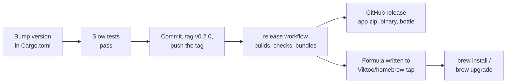

# Releases

**How a build becomes a release that players install with `brew install
viktoo/tap/pocket`.** The game is called **Infinite Pocket** to players. Its worlds
stay `.pocket` files and the command stays `pocket`.



---

## The release number

The `version` in `Cargo.toml` is the release. A build is that release when it is a
clean build of the commit tagged `v<version>`; any other build is `dev` (`build.rs`
sets `POCKET_RELEASE`, read as `db::RELEASE`). Players see `0.1.0`, or `dev <commit>`,
on the worlds list and in settings; `pocket version` prints it.

A world keeps the release and commit that made it (`made_with_release`, `made_with`)
and that last opened it (`last_opened_with_release`, `last_opened_with`).

Playing together needs the same release on both sides: host and guest compare
`db::RELEASE`, `db::COMMIT` and the network protocol when a guest joins, and the one
who is behind is told to update.

---

## Cutting a release

1. Bump `version` in `Cargo.toml` (`0.2.0`), and run `cargo build` so `Cargo.lock`
   follows.
2. Run `cargo test --release --features slow-tests`.
3. Commit (`Release 0.2.0`), then tag and push the tag:

```bash
git tag v0.2.0
```

```bash
git push origin v0.2.0
```

The `release` workflow (`.github/workflows/release.yml`) checks the tag is
`Cargo.toml`'s version, builds on the tag, checks `pocket version` says the same, and
bundles it for Apple Silicon (`scripts/bundle-macos.sh`, which also works locally
after `cargo build --release`). It attaches three files to a GitHub release of the tag:

| File | |
|---|---|
| `Infinite-Pocket-<version>-macos-arm64.zip` | the app |
| `pocket-<version>-macos-arm64.tar.gz` | the bare `pocket` binary |
| `pocket-<version>.all.bottle.tar.gz` | the same binary as a Homebrew bottle |

Then it writes the formula (`scripts/homebrew-formula.sh`) into `Viktoo/homebrew-tap`,
so `brew install viktoo/tap/pocket` gets this release and `brew upgrade` the next.

---

## Homebrew

`brew install viktoo/tap/pocket` pours the bottle: no Rust, and no check of Apple's
command line tools (a formula without a bottle refuses to install when they are older
than macOS). Brew doesn't mark what it installs as downloaded, so macOS opens the
unsigned binary without asking. A copy installed by brew says "brew upgrade pocket"
when a newer release is out.

Set up once, by hand:

1. Make `Viktoo/infinite-pocket` public (the release files and the update check need
   it).
2. Make a public repository `Viktoo/homebrew-tap` (the name brew looks for), with a
   README.
3. Make a fine-grained GitHub token with Contents: read and write on
   `Viktoo/homebrew-tap` only, and add it to `Viktoo/infinite-pocket` as the Actions
   secret `TAP_TOKEN`. Without it the release still happens and the tap is left alone.

---

## Opening the unsigned app

Until the app is signed and notarized (which needs an Apple Developer account), macOS
won't open the zip's app the first time. Open System Settings → Privacy & Security and
click Open Anyway; after that it opens normally. Homebrew installs don't need this.

---

## Updates

On start, a release build's worlds list asks GitHub once for the latest release of
`Viktoo/infinite-pocket` (`net::update::REPO`) and says when a newer one is out, with
its link (Settings → General → **Tell me about new versions**). Dev builds don't ask.
It never updates by itself.

---

## Not done

- Signing and notarizing.
- Intel Mac, Windows and Linux builds.
