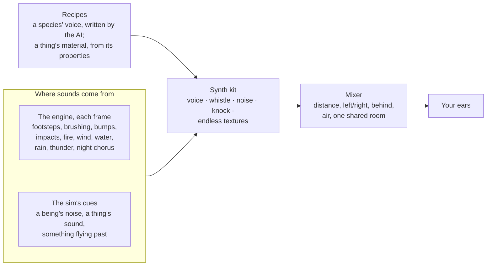

# Sound

**Everything you hear is made live, with no audio files.** Each sound is a small
recipe, played where it happens and heard from where you stand and face. A call
behind you is quiet and dull; turn to it and it's clearer; walk up and it's louder.
Nothing is written for one creature: there is a small synth kit, a mixer that places
sounds round your head, a few sources the engine works out from physics, and one
field the AI fills in for each species.



Code: `src/audio` (`synth.rs`, `foley.rs`, `mix.rs`, `call.rs`, `listen.rs`). People's
spoken lines are a separate system: [voices.md](voices.md).

---

## Principles

1. **Recipes, not recordings.** A sound is a short call: a few parts with numbers,
   stored as text with the species, played at run time.
2. **Never the same twice.** Every play has a seed, and repeats within a call vary a
   little. Each individual keeps its own pitch (from its id and its size against its
   kind's).
3. **Physics sets the register, the recipe sets the shape.** Pitch left unsaid comes
   from the body's mass, and formants always scale with it, so one call fits a kitten
   and a giant.
4. **The AI describes, the engine keeps it good.** The AI answers easy questions (what
   kind of sound, how high, how rough, how long; for things, how hard and dry).
   Hand-tuned mappings turn that into sound, and every number is clamped, so the worst
   a bad answer can do is sound like the wrong animal.
5. **Sound is output only.** The sim pushes cues and never hears back. A test proves
   the same seed makes the same history whether anything listens or not.
6. **Text stays.** Every sound also exists as its `sounds` words and a log line, so
   muted play and tests lose nothing.

---

## The kit (`synth`)

| Kind | What it is | Covers |
|---|---|---|
| `voice` | a throat-like source with breath and 4 vowel formants scaled by the body, optional nasal tube | calls, growls, groans, breath, whines |
| `whistle` | a sine with glide, vibrato, buzz and breath | birdsong, hoots, insects, chimes |
| `noise` | filtered noise grains, from the material | hiss, rustle, splash, crunch |
| `knock` | five struck, decaying modes (wood-like to metal-like by `ring`), a click and a thud | knocks, snaps, clatter, footfalls, impacts |
| texture | endless grains whose drive the game sets each frame | brushing through growth, lapping water, fire |

A part has a `kind`, `hz` (one value or a [start, middle, end] glide), `len`, `times`,
`gap`, `vowel` (up to three of a e i o u m n), and 0–1 sliders `rough`, `breath`,
`nasal`, `wobble`, `swell`, `loud`, plus `hard`, `dry`, `ring` for noises and knocks.
A call is 1–8 parts. `loud` spans about 30 dB, so a purr is truly quiet.

**Material, not identity.** Engine sounds don't know "grass" or "leaves". They read
`hard`, `dry`, `ring` and `leafy` from a thing's properties (alive, burns, wet,
fragile, char) and tags, or from its own `meta.sound`. Green blades swish softly; dead
litter crunches. Only brittle things ring by nature; a bell or a pan says `ring` in its
`meta.sound`.

**Physics decides whether there is a sound at all.** It needs energy going into
something that can make one:

- *Two bodies meet:* the softer damps the strike, the lighter is mostly what you hear,
  and loudness follows the energy. Walking into stone is a dull thud; a dropped pot
  clinks; a struck bell rings.
- *Growth gives way:* walking through anything leafy and light enough to push is a
  rustle; only dry, dead growth met head-on snaps. Trunks don't rustle.
- *Glancing contact* (sliding along a wall) makes nothing.

---

## Hearing from where you are (`mix`)

The listener is your head. Every voice is placed every 128 samples, with values ramped
across, so turning sweeps a sound smoothly.

| | |
|---|---|
| **Distance** | full loudness within 2 m, then falling with distance |
| **Left/right** | equal-power pan, a delay between the ears (up to 0.65 ms), the far ear duller |
| **Front/back** | behind is about 3 dB softer and much duller above ~1.5 kHz, so facing a sound makes it clearer, not only centred |
| **Air** | highs fade with distance. In thin air (the Moon) the world's sounds fade; words still come, as by radio |
| **Under water** | everything dull and low while your head is under |
| **Room** | one shared, dark outdoor reverb that falls off slower than the direct sound, so far things sound far |

Tested (`behind_then_facing_then_walking_up_gets_louder_and_clearer`): a call 30 m
behind and to the left is in the left ear; turned round, it's louder, brighter and on
the right; walking up, ever louder.

---

## Where sounds come from

**The engine** (`foley`, no AI, each frame):

| Source | |
|---|---|
| Footsteps | every grounded walker within 20 m: a thud from the body's mass and a crunch, squelch or splash from the ground. The quietest sound there is, well under a call. |
| Brushing | one texture per moving body through leafy growth: growth about its legs × speed × size |
| Bumps | a blocked step, by how squarely and fast it was met, once |
| Impacts | loose things hitting anything over 1.2 m/s |
| Flying things | what flies fast whooshes (lower and fuller the bigger); a lit fuse fizzes; a gun cracks, a bow snaps, a blast booms |
| Fire | burning things within 70 m, gathered into up to four spots, each a crackle and a low roar |
| Wind | mostly on high, open ground, set by the weather; faint in hollows, woods and indoors |
| Water | the nearest open water, from where it is |
| Rain, thunder | rain patters (a dull drumming under a roof; snow and ash are silent); a crack when lightning is near, then a long roll, late by distance |
| Chorus | singers kept near you: insects at night where things grow, by day the world's own small creatures, else birds where trees stand. They fall quiet round anything that harms. |
| Dread | a low drone while something harmful is near in the dark |

**Calls** (cues from the sim): a being's noise (greetings, fleeing cries), a night
horror's sound, a thing's `sound(i)`. Each plays in the maker's voice and follows it.

- Species get a `voice`: one call per `sounds` line, written by the AI in the same
  answer as the species. Built-ins have hand-tuned ones.
- Missing or unreadable ones are guessed from the words ("a low growl", "two sharp
  chirps"), bent by low, high, soft, loud, long, short, two.
- Things sound as their `sounds` words, at their mass, in their material.

---

## Cost

A crowded test scene (20 calls, 10 brushing textures, 24 singers, wind, water and
dread) renders 4 s in about 0.26 s in release: about 6% of one core. At most 48 voices
are rendered; quieter ones run silently. One reverb for everything.

---

## Listening

```bash
pocket listen --demo [--out DIR]                     # the test scene, materials, every built-in voice, a night, contacts, a fire, as WAVs
pocket listen FILE --species wolf                    # a species' calls
pocket listen FILE --at 0,0,90 --hour 23 --walk --calls --verbose   # stand or walk in a world and record it
```

**Settings:** Sound on or off and Volume, in Settings → Sound. `POCKET_NO_SOUND=1`
turns it off for a run. It is off by itself when there is no output device.

---

## Tests

- Placement: left/right, behind/front brightness and loudness, approach; far sounds
  carry more room.
- Every kind at every size is finite and not silent; seeds repeat exactly and differ.
- Badly written calls stay in range; species with bad voices still load; guesses follow
  words and body; materials follow properties; `meta.sound` is read and checked.
- Hushed singers fall quiet; a dense night stays under budget
  (`a_dense_night_runs_faster_than_real_time`).
- In a world (`noises_bumps_and_impacts_are_heard_where_they_happen`,
  `listening_changes_nothing`): a dog's noise comes from the dog in its own voice; a
  shrub walked past rustles; a boulder walked into is one dull thud; fire crackles
  where it burns; a thrown stone is heard where it lands; listening changes nothing.

---

## Not done

- Occlusion: a ridge or wall between doesn't muffle.
- HRTF for headphones.
- Beings that hear: noise doesn't draw or scare them, and sneaking isn't quieter.
- The shore's sound shaped like waves; seasons and rain shifting materials.
