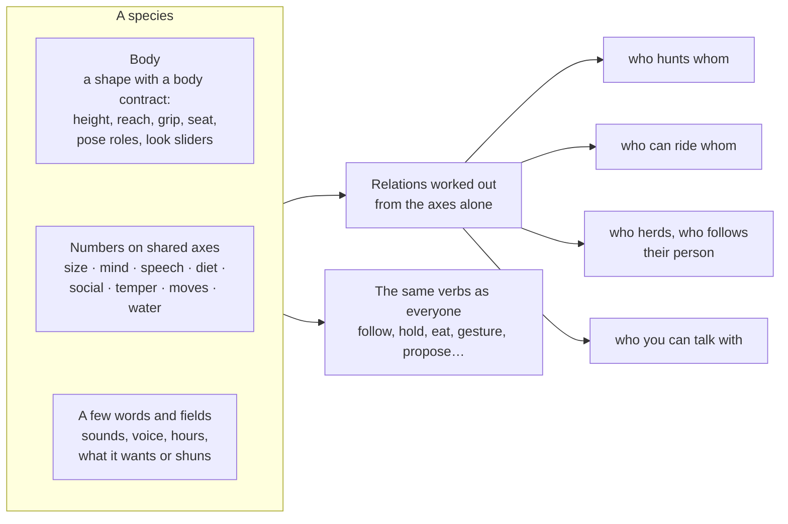

# Species, bodies and lives

**This is how a world gets more than people.** A dog follows its person and brings
back a thrown stick. A cat won't be hugged by a stranger. Goats bolt together from a
wolf. An elf and an orc start out wary and warm to each other one game at a time. A
dragon wraps its wings round the one person it loves.

None of this is scripted per species. Every species is a **body** plus a few
**numbers on shared axes**. Every body answers to the same **pose roles**. The verbs,
needs, relationships and rules everyone already has do the rest. So the AI can write
a new species in one call and it behaves without new code.



**Principles**

1. **Meaning apart from animation.** A hug is consent, affection, distance and a
   change in a relationship (`social.rs`). How a body shows it is up to that body.
2. **Pose roles, not limbs.** Gestures move roles ("reach toward", "lower head"). Each
   body decides what a role moves: arms, wings, paws, a neck.
3. **Behaviour comes from the axes, never from names.** A wolf scares a goat because
   it eats meat and is bigger, not because it is a "wolf".
4. **Same verbs for everyone.** What a dog can't do, it can't do because of its body
   or mind, not because of a special case.
5. **Humans are one species.** You stay the human-shaped traveler, but your size and
   dress are values like anyone else's.
6. **Looks are data.** "A warrior village" or "everyone is a giant" changes values and
   adds layers, never engine code.

Built in: people, dogs, cats, horses, wolves, goats and deer (`src/builtin/species.json`).
Worlds add their own at genesis and in region plans. Code: `src/world/species.rs`,
`src/sim/beings.rs`, `motion.rs`, `life.rs`, `carry.rs`.

Scope: bodies from cat size (about 0.4 m) to dragons (about 12 m), and water life big
enough to see (carp, seals, sharks, whales; a school of small fish drawn as one body).
Nothing smaller: at low detail a mouse is a pixel. No swarms, insects or small birds.

---

## The body contract

A body is an ordinary kind of thing (the same checked code as any other) with the tag
`body` and a `body` block in `meta`:

```js
export const meta = { name: "dragon", bounds: [6, 5, 12], tags: ["body"],
  props: { mass: 4000, burns: 0, heat: 40 },
  body: {
    height: 5, eye: 4.2, radius: 2.5, reach: 3.5,
    grip: [0, 3.8, 5.5],      // where held things sit: a mouth, a claw, a hand
    seat: [0, 3.2, 0.5],      // where a rider sits (leave out if it can't be ridden)
    roles: ["reach_l", "reach_r", "raise_l", "raise_r", "head", "crouch", "lean", "spread"],
    gait: "quad",             // biped | quad | slither | hover
    flies: true
  } };
```

| Field | |
|---|---|
| `height`, `eye`, `radius`, `reach` | its size, where it sees from, collision, how far it reaches |
| `grip`, `seat` | where a held thing sits; where a rider sits |
| `roles` | the pose roles its shape answers to |
| `gait` | how the walk runs: per metre by size (`biped`, `quad`), along the body (`slither`), or in time (`hover`) |
| `flies`, `arms` | it can fly; it has two hands (big things are held in both) |
| `look`, `usual` | its look sliders with ranges (read as `k.a` … `k.e`, then `k.g` … `k.z`), and which have one usual value (most people are dressed) |
| `from` | the body it was written from: layers and kin follow the line |
| `rest`, `dead` | how it stands at rest and how it lies dead, per role |

A body's `parts(x, y, z, k)` says where its hands, head and chest are, so what it
holds sits in its hand and what it wears fits.

**Pose roles.** Nine slots, each body giving them its own meaning, so every gesture
plays on every body:

| Role | Human | Dog | Dragon |
|---|---|---|---|
| `raise_l`, `raise_r` | arm up sideways | front paw up | wing up |
| `reach_l`, `reach_r` | arm forward | paw forward | wing wraps forward |
| `lean` | bend at the hips | play bow | neck forward |
| `head` | nod | head down | head down |
| `crouch` | crouch, sit | sit, lie | lie down |
| `spread` | | tail wag | wings spread |
| `grip` | close the hand | close the mouth | close the claw |

The probe drives each listed role from 0 to 1 and checks the shape stays sound, in
bounds and actually changes. Bodies get a tighter fuel budget than other things, since
many are on screen at once.

**Template bodies.** `figure` (people) and `quadruped` are starting points. A species
drawn with one gets its own body written from it in the background once it is about
(`POCKET_SIM_OWN_BODIES=0` turns this off), with every role kept. Without an AI the
templates are what everyone wears. One being's body can be reshaped by a deed ("a
poofy tail"): its own body is written from the one it has, so it still walks, gestures
and fits a collar, and its young take after it.

---

## The shared axes

| Axis | Values | What it drives |
|---|---|---|
| `size` | metres | who looks dangerous, who can carry whom, hug distance, how far you notice it |
| `mind` | `instinct` · `simple` · `sapient` | `instinct`: the scorer only, no AI. `simple`: asks the planner rarely (every 5 game minutes), no words. `sapient`: full minds, plans, crafts, makes things |
| `speech` | `none` · `sounds` · `words` | can you talk with it? `sounds` answers in noises and gestures. Gossip passes only between those that share words. |
| `diet` | weights for plants, meat, and any property | what counts as food for it, and who is prey |
| `social` | `solitary` · `pair` · `pack` · `herd` · `village` | who it seeks out, how far it strays from its group |
| `temper` | bold, wary, playful, tame (0–1) | fear and flight distance, play, how quickly it warms |
| `moves` | walk, run, fly, swim speeds | paths, flight, escape |
| `water`, `depth` | 0 land … 1 only water; a depth band | where it lives and swims; at 1 it never leaves the water |
| `caves` | true / false | its home is a cave floor and it keeps to caves ([levels.md](levels.md)) |
| `life`, `needs` | sleep hours; how fast each need drifts | a dragon is rarely lonely, a dog often is |
| `mass` | kg at full size | carrying, riding, hunting |

And a few fields for what a species is like:

| Field | Example |
|---|---|
| `sounds`, `voice`, `tone` | "woof", "a low purr", each with how it sounds; how speakers sound ([voices.md](voices.md)) |
| `active` | `night` for owls, moths and horrors |
| `want`, `touch`, `drive` | what it goes after, what its touch does, a purpose told to its mind |
| `shuns`, `moves_unseen`, `hostile` | won't come near light; moves only while you aren't looking; means harm (the night's phantoms) |
| `props` | its body beyond a plain living one: a fire spirit is hot, a ghost cold |
| `weather`, `comes_with` | how it feels about rain or snow; it comes out only in fog ([weather.md](weather.md)) |
| `breathes` | it needs air (false for a golem or a ghost) |
| `signs` | what you notice when it's near but out of sight ("a rustle behind you") |

**Relations worked out from the axes**

- **Hunting.** A hunts B when A eats mostly meat, isn't sapient, B isn't its own
  species or kin, and B weighs less than 0.8 of A, counting A's pack within 30 m. A
  sapient B is hunted only by the very bold. You are never hunted. Prey keeps its
  distance; plant eaters with any wariness keep away from meat eaters, which is what
  makes a mount bolt. With `POCKET_SIM_HUNTING=0` predators only chase.
- **Riding.** The mount must weigh at least three times its rider, carry them, have a
  seat, and agree (tame, plus liking the rider). A wild horse throws off a stranger; a
  frightened mount that isn't fully tame throws its rider.
- **Pets.** A relationship `"Bren: owner"` on a beast means following, greeting and
  fetching, through the usual verbs.
- **Groups.** `pack` and `herd` keep near their kind; a herd flees together.
- **Peoples.** Genesis can seed a starting feeling between sapient species (elves and
  orcs: trust −0.4). It is only where a new pair starts; each person's own history
  takes over.

---

## Looks, varieties and layers

- **Sliders** are the body's own named look values with ranges: a person's height,
  build, skin, face, hair and clothes (see the `look` list in `REGION_TASK`); a
  dragon's scales and horns. A species and each variety narrow the ranges.
- **Varieties** are named slider ranges plus default layers: "hill folk", short and
  broad in wool cloaks; "a warrior village" in armour. They are data, so they cost no
  AI call when they reuse existing layers.
- **Layers** (armour, a cloak, a saddle) are small modules with the tag `layer`,
  written against one body's code and drawn in its frame and pose. They are live
  things: a cloak burns, armour makes you heavier. They are reused by name and fit any
  body down the line (a quadruped's collar fits a cat). `wear` and `take_off` are
  shared verbs.
- **World scale.** Genesis can scale species ("everyone is a giant") and your own
  height. Eye height, reach, speed and lifting follow from size, so "small among
  giants" plays out with no special code.

---

## Gestures across bodies

A gesture is role poses, so every gesture plays on any body that has those roles. If a
body lacks a role a gesture needs, a fallback is used (`head` for a nod). If nothing
fits, the AI writes that species' version once, kept as `name@species` (`cheer@naga`).

---

## Minds by species

There is one mind (`npc.rs`). The species scales how needs drift, sets the sleep
hours, adds the group, fear and owner options, and maps diet onto eating. `instinct`
and `simple` minds don't use the dialogue model: pressing `Enter` near a dog gets a
noise, a gesture and an action. They still remember: a dog remembers who fed it.
Traits start from the species' temper and are shaped by the persona's words.

---

## Flight and riding (`motion.rs`, `carry.rs`)

- A flyer cruises a few metres over the highest solid near its path and lands to eat,
  sleep, hold or touch. Flight is a way of moving inside `goto`, chosen when the
  target is far or across water.
- **Riding** puts one body in another's seat (`ride`, `dismount`). You steer with the
  walk keys at the mount's speed; on a flyer, `Space` and `c` (or looking up or down
  while moving) climb and dive. Characters take their own mount for long trips.
- The mount's own mind keeps running: fear makes it bolt, tiredness slows it, gentle
  rides and feeding make it like the rider more.

---

## Deeds on beings

The `/` path works on beings too, and never writes free text into a body's code.

| | |
|---|---|
| **Dress** | `/give the guard a red cloak` adds or removes a layer. A person has to agree; a tame animal accepts a collar from someone it likes. |
| **Change values** | `/feed the horse`, `/calm the dragon`, `/teach the dog to sit` change needs, feelings, sliders within range, or teach a gesture. Cached like every deed. |
| **Transform** | a curse that turns someone into a toad, only in a world with forces of its own (or `POCKET_SIM_TRANSFORM=1`). Memories and relationships survive. |
| **Create** | `/conjure a hound` makes a being of an existing or new species, on by default (`POCKET_SIM_CREATE_BEINGS=0` turns it off). The maker becomes its owner. |

---

## Lives (`life.rs`)

- **Young.** Two bonded beings of one body line (people: partners) can have young.
  Each slider is the parents' average plus a small drift; temper blends the same way;
  the parents' variety is kept. Young start small, follow a parent and grow up over
  some game days. Family relationships are set at birth.
- **Limits.** Kin within 150 m count against `POCKET_SIM_MAX_CREATURES` (24), and births
  slow as a place fills. `POCKET_SIM_LIFE_SPEED` speeds lives up or stops births.
- **Drift.** Young of parents fed by people are a little tamer; hunted lines warier.
  Judged by a line's three youngest, a line that drifts far enough is named a variety
  ("tame wolves"), and further, a species of its own, with no AI call. A new species
  keeps `kin_of`, so it shares its ancestor's limit, and everyone uses its new name.

---

## Tests

Each is in `src/sim/tests`:

| Test | Shows |
|---|---|
| `a_dog_plays_the_same_gestures_with_its_own_body` | one gesture code on two bodies; a mouth grip |
| `a_dog_follows_and_fetches_and_a_wary_cat_keeps_its_distance` | owners, fetch, a refused hug, noises not words |
| `wolves_chase_a_herd_and_peoples_warm_to_each_other` | prey, herds, never people; elves and orcs warming |
| `llm_written_species_live_hug_and_learn_their_own_gestures` | a dragon's wing hug; a naga's own cheer, written once |
| `a_warrior_village_wears_its_armour_and_giants_dwarf_the_traveler` | varieties, layers that burn, world scale |
| `deeds_dress_feed_teach_curse_and_conjure_beings` | consent, values, transform, create |
| `species_get_own_bodies_and_one_being_can_be_reshaped` | template bodies replaced; one cat's tail made poofy |
| `griffins_fly_horses_carry_and_bolt` | flight, riding, a mount bolting |
| `families_grow_and_a_fed_wolf_line_turns_tame` | young, growth, limits, drift into a named variety |

`pocket sim` metrics count events between species, chases and pets following their
people. If these stay flat, the axes aren't doing anything.

---

## Not done

- Layers that change what a body can do (wings on a saddle, a jetpack). Waiting to see
  what people try.
- Playing as another species: you stay the human-shaped traveler.
- Nothing burrows or climbs rock; every body moves the same way over the ground (gait
  only sets the animation).
