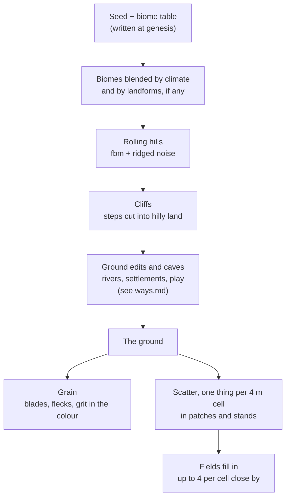

# The land: shape, cliffs, fields and woods

**This is how the ground and everything growing on it comes from the world's seed.**
The land is a pure function of the seed and the world's biome table, so nothing of
it is stored and it goes on forever. It exists twice, in Rust (for bodies, physics
and the AI's map) and in WGSL (for drawing), and tests keep the two in agreement.



| Part | Where | What the world's AI can set |
|---|---|---|
| Landforms | `landforms.rs`, `lands_at` in `common.wgsl` | coasts, bays, ranges, an island |
| Hills | `terrain.rs` | each biome's `amp` and roughness |
| Cliffs | `Terrain::cliff`, `cliff_h` | each biome's `cliffs`, 0 to 1 |
| Grain | `Grain`, `ground_grain` | each biome's `grain` |
| Scatter | `world/scatter.rs` | each biome's density per tag, and `clump` |

Ground shaped by people (canals, roads, terraces), rivers and caves are in
[ways.md](ways.md).

---

## Landforms: the land's large shape (`landforms.rs`)

A world may give its land a shape (genesis `landforms`): outlines or lines in world
metres, each turning its area into one of the world's biomes, with a soft border
(`edge`), an optional lift (`rise`), and how broken that lift is into ridges and
canyons (`rugged`). Later ones lie over earlier ones. Genesis is asked for them when
the words name a real place or a clear shape (an island, a valley between ranges);
you then start at the origin, where they put the start.

They are baked once into a map (at most 640 samples a side, at least 48 m apart) of
biome shares and a rise per sample. The terrain blends them over the climate's
weights and adds the rise before the hills, on CPU and GPU alike. Outside the map
the seed's land goes on as ever. Worlds without landforms are unchanged.

---

## Cliffs (`terrain.rs: Terrain::cliff`, `common.wgsl: cliff_h`)

A biome's `cliffs` (0 to 1) says how much of its relief stands as cliffs. The rolling
height is cut into steps 5–12 m tall. In each step the ground keeps a fifth of its
slope as a ledge, then rises the rest of the way in a face.

| | |
|---|---|
| **Only where there are hills** | a face is as tall as the step it replaces. No cliffs where the biome's `amp` is under 3 m, all of them from 12 m, so a town stays level. |
| **In stretches** | a slow noise decides where a cliffy biome has them: at 0.3 the odd crag, at 0.7 canyon country, at 1 nearly all its hills |
| **Rugged** | where a step is cut wanders a little, and a face's foot wanders in and out (buttresses and clefts) |
| **Gullies** | in places a face slumps into a steep, walkable slope, so the ledges above can be reached |
| **No seams** | the cut is continuous everywhere, for the raymarcher and for feet |
| **Rock in beds** | steep ground is the palette's rock, banded in level beds |
| **Talus** | boulders and stones heap at the foot of sheer faces |
| **Old worlds** | a biome saved without `cliffs` reads 0, and its ground is exactly what it was (tested) |

**Walking** (`world/collide.rs: too_steep`). Ground steeper than `MAX_CLIMB` (1.4,
about 54°) stops anyone walking up it, and they slide along its foot. Down it they
go. Dug ground doesn't count (anyone climbs out of a pit), nor does ground under a
body standing on something. `describe` calls a face a `cliff`.

**Drawing.** The camera-centred heightmap has 0.75 m cells, too coarse for a sheer
face, so any cell whose corners differ by more than 1.2 m is drawn from the exact
height, by primary and shadow rays alike.

---

## Patches and stands (`world/scatter.rs`)

The land is split into 4 m cells, each holding at most one scattered thing. Each
kind grows in patches of its own: a noise field per tag, 0 outside and 1 in a patch's
heart, with frayed edges. A biome's density for a tag becomes

    density × ((1 − c) + c × depth × 2.6)

where `c` is how strongly the kind clumps (the biome's `clump`, else the kind's own),
and 2.6 (`PATCH_BOOST`) keeps the average where the density says (tested within 15%).

| Kind | Clumps | Patch size | Looks like |
|---|---|---|---|
| tree, palm | 0.6 | 60 m | woods with clearings, lone trees between |
| pine | 0.45 | 80 m | forest with glades |
| flower | 0.9 | 24 m | fields, bare grass between |
| tallgrass, reed, fern | 0.85 | 22 m | meadows and reed beds |
| bush | 0.5 | 28 m | thickets |
| rock | 0.55 | 36 m | boulder fields |
| stone | 0.3 | 30 m | |
| mushroom | 0.7 | 14 m | rings and clusters |
| grass | 0.45 | 30 m | lusher and thinner ground |
| stick | 0 | | lies where the trees are |
| anything else | 0.5 | 40 m | |

- **Stands.** Within a stretch a little wider than its patches, one of a tag's types
  leads (three in four of its things), so a birch wood gives way to an oak wood
  instead of every tree being random. Things in a stand share `k.a` (0 to 1): a flower
  field's colour, a grove's tint, a meadow's ripeness. `k.b` is how deep in its patch
  a thing stands. Trees grow tallest in the heart of a wood.
- **Fields fill in** (`is_cover`, `sub_cell`). One thing per 4 m cell is too few for
  a field. Where ground cover (flowers, tall grass, grass, reeds, ferns) is chosen in
  the thick of a patch, up to three more fill the cell's other 2 m quarters, showing
  within 40 m. Each quarter has an identity of its own, so picking, eating or burning
  one flower is remembered for that flower alone.

**Built-ins.** `wildflowers` (tag `flower`: buttercup, daisy, violet, poppy or
cornflower by the stand's `k.a`) and `tall grass` (tag `tallgrass`, green to straw by
`k.a`). A world's own types of a tag replace them. The default biomes have flower
fields (meadow, heath), tall grass (meadow, lakeshore, highlands) and cliffs
(highlands 0.7, heath 0.3, pine forest 0.15).

---

## Ground grain (`Grain` in `terrain.rs`, `ground_grain` in `common.wgsl`)

Every biome's ground carries a fine texture drawn into its colour, so it costs no
geometry. Genesis may set it:

```json
"grain": { "blades": 0.6, "flecks": 0.4, "fleck": [78, 108, 48], "fleck2": [200, 172, 104] }
```

| | Shows within | |
|---|---|---|
| `blades` 0–1 | ~45 m | fine blades combed along a way that wanders (grass, reeds, heather); 0 for sand, mud, snow or rock |
| `flecks` 0–1, `fleck`, `fleck2` | ~70 m | small spots in clusters, in two colours (clover and straw, fallen leaves, pebbles, lichen) |
| mottle | ~220 m | clumps carrying on into the distance |

Left out, it is chosen from the ground colours. Laid ground (roads, squares, quays)
has its own grit (`ground::pattern_shade`): a soft mottle out to 120 m and, close up,
small stones a little lighter or darker than the ground.

---

## For the world's AI (`prompts.rs`)

Genesis may give each biome `cliffs` (0 to 1, with `amp` 15+), `clump` (per tag) and
`grain`, plus `landforms` for the whole land. It is told that flowers and tall grass
exist, that a patch's things share `k.a`, and that cover should be drawn as clumps.

---

## Tests

| Test | Covers |
|---|---|
| `terrain::tests` | old worlds unchanged, faces and ledges, flat land stays flat, no jumps, boulders find the foot |
| `world::collide::tests` | faces stop a climber but not a descent; anyone climbs out of a pit |
| `world::scatter::tests` | density kept, patches patchy, stands hold, quarter identities |
| `sim::tests::fields_woods_and_screes` | quarters picked one by one, sticks under trees, boulders under cliffs |
| `sim::tests::a_rock_face_is_seen_as_a_cliff` | `describe` names it |
| `render::tests::cliffs_agree_on_gpu_and_cpu` | 12k points on faces: worst error 2.5e-4 m |
| `render::tests::landforms_agree_on_gpu_and_cpu` | landforms the same on both |

`sim::tests::land_pictures` (ignored) writes maps and views of a default land and of
red canyon country to `POCKET_PNG_OUT`.
