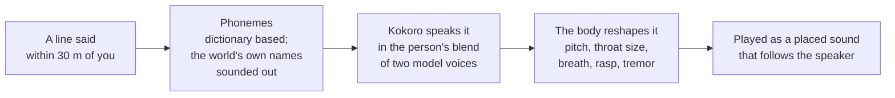

# Voices and speaking to talk

**People in the world speak their lines out loud**, each in a voice of their own, from
where they stand. Turn toward them and walk up, and they get clearer and louder, like
every other sound. **You can talk back by speaking**: turn on Speak to talk and your
words fill the input line as you say them.

Both run entirely on your machine. Nothing is sent anywhere and nothing is paid per
line.

| | Voices (people speaking) | Speak to talk (you speaking) |
|---|---|---|
| Model | Kokoro, 82M parameters (Apache 2.0) via ONNX Runtime | whisper.cpp, `ggml-base.en` (MIT) |
| Download | 354 MB, once, into `~/.pocket/voice`, from github.com/thewh1teagle/kokoro-onnx | 148 MB, once, into the same folder, from huggingface.co/ggerganov/whisper.cpp |
| Setting | Settings → Sound → **Voices** (needs Sound) | Settings → Sound → **Speak to talk** |

Both are off for a new player and nothing is fetched unasked: until its files are
there, each row in Settings → Sound is a **Download** button with the size, a line on
what it is, and its public page as a link. When the download finishes the setting turns
on (`voice::pack::VOICES` and `SPEECH`).
| Turn off for a run | `POCKET_NO_VOICE` | `POCKET_NO_MIC` |
| Code | `src/voice`, `src/app/voices.rs` | `src/ears`, `src/app/ears.rs` |

---

## How a line is heard

1. Someone says something within 30 m of you: chat, a call in a game of catch, or a
   reply to you. A reply is spoken a sentence at a time while it is still streaming in.
2. The voice thread turns it into phonemes (`misaki-rs`, dictionary based). Words no
   dictionary knows, mostly the world's own names, are sounded out by `names.rs`
   instead of spelled letter by letter.
3. **Kokoro** speaks them in the character's blend of two model voices.
4. **The body** (`body.rs`, the WORLD vocoder) splits the speech into pitch, the
   throat's resonances and breath, reshapes each (pitch and its range, throat size,
   breathiness, rasp, an old voice's tremor), and puts it back together.
5. The clip plays through the mixer as a placed voice that follows the speaker, and
   their mouth moves with it. A speaker's next sentence waits for the last to end.

The sim spaces a conversation's lines by how long each takes to say at the speaker's
pace (`voice::secs`), heard or not, so talk keeps a human rhythm.

---

## A person's voice (`recipe.rs`)

Read off who they are, with no extra AI call:

| | |
|---|---|
| **Sex** | from how they are described (woman, fisherman, grandmother, beard…) |
| **Age** | children small and high; the old slower, shakier, rougher, breathier |
| **Height and build** | taller means a longer throat and a lower voice |
| **How they speak** | the persona's `voice` line: slow or quick, gruff, soft, deep, shrill, flat, lilting, nervous each move a slider |
| **Their own** | two model voices of the right kind (US or British, so the pronunciation matches) in a mix of their own, and a small offset from their id. The same person always sounds the same. |

### Tone: numbers the AI writes

Over that guess, a character's `tone` (and their species' `tone` under it) says
outright how they sound:

| Number | Does |
|---|---|
| `pitch` (Hz), `range`, `size`, `pace` | how high, how much it moves, the throat's size, how fast |
| `breath`, `rough` (0–1) | breathy, rasping |
| `whisper` | breath and no voice; past 0.75 no pitch at all |
| `under` | the same speech again an octave down from a bigger throat, mixed in |
| `hollow` | the throat's resonances combed every 550 Hz, plus a short ring |
| `waver`, `waver_hz` | a tremor, at a chosen rate |

All of it is done by the body after the model has spoken. The phantom's species
carries a stock tone, like its stock body.

---

## Speaking to talk

Press `/`, or `Enter` with someone, and the mic opens. Words show in the input line as
they are made out.

- A pause (1 s) or `Enter` closes the mic, and the words wait in the line to be read
  over and edited. **Only `Enter` sends them**, as with typed text, so nothing heard
  goes out unseen.
- Typing (Backspace too) takes over at once: the mic closes and the words stay to edit.
  `Esc` forgets what was heard. With someone, `Enter` on an empty line listens again.
- The mic is open only while listening. Turning the setting on opens it once so the
  system asks for permission right away. On a Mac a release build played from a
  terminal starts itself again as its own app (`src/own_app.rs`), so the system asks
  for Infinite Pocket, with the reason in the `Info.plist` that `build.rs` puts in the
  binary, not for the terminal. A dev build is asked for as the terminal.
- **Recogniser:** on the CPU with the voices' share of threads, live words every 0.4 s
  take 30–80 ms, and the whole line at the pause about 0.3 s. The names of who you're
  with, what you point at and what you hold are given as a prompt, so they come out
  spelled right. Metal works too (`POCKET_EARS_GPU=1`), but the GPU is the world's.
- **Pause** (`pause.rs`): loudness against the room's noise, so a fan or rain doesn't
  keep it open. Nothing said for 8 s closes it; one go is at most 28 s.
- **Why not the cloud:** cloud recognisers are more accurate on odd words and cheap,
  but need a key, send your voice away, and add the network to every line.

Building from source needs `cmake` (for whisper.cpp): `brew install cmake`.

---

## Speed

On an M5 Pro with 4 threads (a quarter of the cores, at most 4), a 4-second line takes
about 1 second to make: the model 0.8 s, the body 0.15 s. The frame rate is the same
with voices and the recogniser on or off.

---

## Tools

| Command | |
|---|---|
| `pocket listen --voices [FILE] [--say TEXT] [--fetch]` | a built-in cast, or a world's speaking people, each saying a line, as WAVs, with their recipes and timings |
| `pocket listen --hear F.wav [--model PATH] [--gpu]` | a recording heard as in the game, each pass timed |
| `pocket listen --mic` | one go through the microphone |
| `POCKET_MIC_WAV=F.wav` | the game hears that file as the mic (for `--shot` runs: `--keys / --keys-at 8`) |
| `POCKET_VOICE_DIR` | where the voice pack lives |
| `POCKET_VOICE_HARVEST=1` | the slower, steadier WORLD pitch tracker, to compare against the default |

The voice pack is `kokoro-v1.0.onnx` (325 MB) and `voices-v1.0.bin` (28 MB), from the
kokoro-onnx project's GitHub release. The game binary is about 65 MB bigger for ONNX
Runtime and the pronunciation dictionaries.

---

## Not done

- Mood in the voice (calm, scared, angry) from the sim's state.
- Making lines ahead of time that you can't hear yet.
- A smaller binary, by loading the pronunciation dictionaries from the voice pack.
- Hosting the voice pack on the game's own release.
