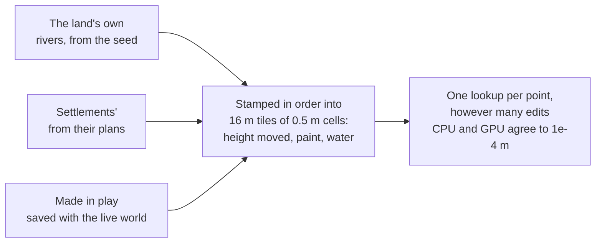

# Ways, water and hollows

**This is how the land gets shaped the way people shape it**: canals and lagoons,
islands and terraces, streets that follow the hills, bridges, rivers, ponds, and
caves you walk down into. Nothing in the engine knows "Venice" or "canal". It knows
a few primitives (ground edits, water levels, hollows), and the AI fills them in for
each place.

| Primitive | What it is | Where it comes from |
|---|---|---|
| **Ground edit** | lower, raise, level or paint the ground along a line, an outline or a disc | rivers (from the seed), settlement plans, deeds in play |
| **Water level** | a surface standing over some ground | the sea, ground water, a basin that fills, an edit's `water` |
| **Hollow** | a few capsules cut out of the solid ground, with a mouth | caves from the seed, plans, deeds, shapes set into the ground |

Vehicles and seats, which make use of these ways, are in [physics.md](physics.md).
Homes dug into the ground and up in the trees are in [levels.md](levels.md).

---

## 1. Ground edits (`ground.rs`)

An **edit** is:

| Part | |
|---|---|
| **shape** | a line through points with a width, an outline, or a disc |
| **mode** | `lower` to a height (only higher ground), `raise` to it (only lower ground), `level` at it (either way), or `paint` (height untouched) |
| **height** | one value, or one per point of a line (a road climbing a hill, a river falling) |
| **edge** | how far the sides slope: 0.3 m a quay wall, 2 m a bank, 10 m a shelving shore |
| **colour**, **rim** | cobbles, gravel, a canal's murky bed; quay stones or a kerb along the top |
| **water** | a level standing over it: a pond, a river, a canal on a hill |
| `kind`, `name` | words, for the story only |



Edits apply in order, each on the ground the ones before left. Reading the ground is
one bilinear lookup on the CPU (`Ground::at`) and on the GPU (`ground_*` in
`common.wgsl`, the tiles round the camera uploaded as one buffer, a 640 m window
moving in 64 m steps). Changing an edit restamps only the tiles it touches, on all
cores. Roads are edits too.

---

## 2. Settlements shape their land (`settle.rs`)

A region plan's settlement may have a `ground` list. Each entry has one shape
(`line` with `width`, `circle`, `rect` with an angle, or `outline`), `how` (`cut`,
`fill`, `level`, `paint`), a `height` (0 is the sea; leave it out for a street that
follows the land), `sides`, `color`, `rim`, `rim_width`, `water`, and `frontage`.

```json
{ "what": "lagoon", "circle": [128, 128, 110], "how": "cut", "height": -1.8 },
{ "what": "island", "rect": [128, 128, 120, 90, 10], "how": "fill", "height": 0.8 },
{ "what": "canal", "name": "Rio Novo", "line": [[70, 120], [190, 135]], "width": 7, "how": "cut", "height": -1.6,
  "frontage": { "type": "house", "sides": "both", "every": 11 } }
```

They are laid in order. Streets read their heights off the ground shaped before them,
stay above water, and cross the sea as causeways. Cuts along lines go last, so canals
cut through streets.

| | |
|---|---|
| **Frontage** | buildings of a type lined along a line (both sides, left or right, every N metres), set back past its edge, doors turned toward it |
| **Roads** | with streets, each door gets a spur to the nearest one; without, roads join the doors |
| **Bridges** | wherever a way crosses a cut, the built-in `bridge` (or the plan's own) is set at the way's height, humped so boats pass under |
| **The vehicle** | one per settlement, named by the plan (`"boat"` exists); a boat is moored by a quay |
| **Lamps** | along streets as along roads |

Your start point and people's homes move off ground a settlement flooded. The region
prompt (`REGION_TASK` in `src/prompts.rs`) describes all this in general words: a
canal city, a harbour, a moated keep, terraces, a causeway.

---

## 3. Rivers (`rivers.rs`)

Springs on high ground (one chance per 512 m cell, more in a wetter land: the look's
`rivers`, 0 to 1, set at genesis) run downhill along the smoothed land with momentum
and a wander. Water never climbs: land in the way is cut as a gorge up to 7 m deep,
or else the river ends in a pond. It widens and deepens as it goes, has sandy sides
and low banks, and runs out into the sea.

A river is a pure function of the seed, so only stretches within 750 m of you are
laid, again on another thread every 250 m you walk.

---

## 4. Where water stands

Three primitives decide where water stands. Nothing knows "lake", "well" or "cave
world".

| | |
|---|---|
| **The sea** (`Look::sea`) | the world's own level, 0 by default, or none: a land with no sea (a desert basin, the Moon), where low ground is only low ground |
| **Ground water** (`Look::groundwater`) | metres under the land's own surface: ground dug deeper fills with water up to it. A marsh fills a hole half a metre down; a desert none. |
| **A basin fills to its lip** (`ground::basin`) | from the bottom of a hollow the water rises over the ground joined to it until the next ground lies lower than it (it would run out there). So a pond dug on a slope fills only to its downhill edge. A deed's `"fill": true` is a basin with no cap (a pond, a lake on a mountain, a moat). |

`Terrain::water(x, z)` is the surface over a point. Swimming, wading, floating,
boats, grass and reeds, sounds, descriptions and the planner's map all read it.

---

## 5. Caves (`terrain.rs`)

A **cave** is a few capsules (a passage, a chamber) with a mouth where it meets the
surface. The ground is solid below its surface **and outside every hollow**.

- The renderers march exactly that: rock and earth inside, the sky's light fading with
  depth, no sea inside. The 32 hollows nearest the camera go to the GPU.
- `Terrain::floor(x, top, z)` is the highest ground at or below a point, so bodies
  stand on cave floors, walls and low roofs stop them, and things fall to the floor.
- People find their way in and out through the mouth as through a doorway.
- Caves come from the seed (hillside caves; the look's `caves`), from plans
  (`{ "what": "cave" | "mine" | "cellar" | "crypt" …, "mouth", "toward", "length",
  "depth", "room" }`; things whose `near` names one lie on its floor), and from deeds.

What lives in caves, and shapes set into the ground, are in [levels.md](levels.md).

---

## 6. Shaping the land in play (`sim/interp.rs`)

A deed's `ground` effect may carry a `way`. A canal, ditch or moat is cut from the
doer the way they look or to where they point; joining a river or the sea, it fills
with that water. A road or path is laid level in its colour. A causeway or dyke is
built up. A tunnel (a mine, a burrow) digs a real hollow. A character does a stretch
at a time; you get as much as you ask for. It is all saved with the live world.

---

## Tests

| Test | Covers |
|---|---|
| `ground::tests` | canals and quays, order and heights along lines, islands and ponds, restamping only changed tiles, the window |
| `settle::tests` | a canal city plan read and laid, frontage, crossings |
| `rivers::tests` | water only goes down, ends at the sea or a pond, the same from anywhere |
| `render::tests::ground_edits_agree_on_gpu_and_cpu` | CPU and GPU agree |
| `sim::tests::ways` | a canal city (lagoon, island, canal, houses facing it, the bridge, the moored boat, the same after loading); a villager rowing round the island; beasts pulling carts, legs pedalling, sails needing wind; a river bridged by a street; a dwelling dug under flat ground; land shaped in play surviving a save |

Pictures, by hand: `POCKET_PNG_DIR=… cargo test --release canal_city_png -- --ignored`
(also `river_png`, `cave_png`).

---

## Not done

- Water doesn't flow: a full basin doesn't spill into a river, rain doesn't fill
  hollows, and a filled hole doesn't drain if dug deeper beside it. No locks.
- Water is the only liquid: lava or oil have no level of their own.
- Settlement plans' cuts don't take the ground water (only deeds and blasts do).
- Rivers don't join into one wider river; where two meet they overlap.
- Cave floors are the curve of their capsules: no flat floors or stairs of their own
  (a ladder or stairs is a thing set in one).
- Hearing and seeing don't count floors and rock between (someone in a cave hears the
  street above).
- Land vehicles drive straight at where they go, not along roads.
- Regions planned in an older world keep their old layout; new regions use all this.
