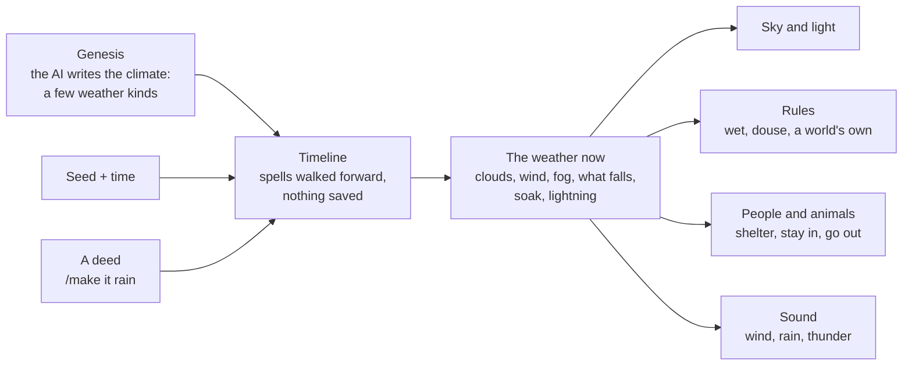

# Weather, clouds and sunsets

**Each world has weather of its own**, written once when the world is made: fair days,
drizzle, sea fog and storms, or ash fall and glimmer rain in stranger places. Clouds
drift and throw shadows, sunsets light them from below, and what falls acts on the
world: rain wets things and puts fires out. People and animals feel it their own way.
Most get out of the rain; a frog folk goes out in it.

There is one weather state per world, and the sky, the light, the rules, the people
and the sound all read the same moment. Nothing knows what rain is: rain, snow, ash,
petals and moon-rain are the same record with different numbers.



Code: `src/world/weather.rs` (climate, timeline), `src/sim/weather.rs` (the living
world), tests in `src/sim/tests/weather.rs`.

---

## Primitives

| | |
|---|---|
| **Climate** (`look.climate.kinds`) | each weather kind is a few numbers: `often`, `hours` [shortest, longest], `clouds`, `cloud_color`, `wind`, `fog`, `tint`, `storm` (lightning), `feel` (words), and `falls`: what comes down (`what`, `amount`, `color`, `look`: streak, flake or mote) and what it does to what it lands on in the open (`props`: rain `{ wet: 1 }`, snow `{ wet: 0.4, temp: -2 }`, or the world's own properties). Worlds without one get fair, cloudy and grey days with nothing falling. |
| **Timeline** (`Weather::at`) | spells walked forward from the seed and the time, so nothing is saved and catching up headless works. Kinds blend over up to two game hours; showers come and go within a spell; the ground soaks while it falls and dries after; clouds drift with the wind; lightning strikes are hashed from the time. |
| **Made weather** (`Spell`, kv `sim.weather`) | a deed's answer may carry `"weather"`: your `/make it rain`, or a character using the world's own magic. It holds for its hours, then the climate returns. |
| **Feelings** (`species.weather`) | `{ "rain": 0.9, "storm": -0.9 }`, keyed by a kind's name, what falls, or a plain word (rain, snow, storm, wind, fog, clear). Weather it doesn't name: it minds what falls, storms and gales. Cats hate rain; dogs like snow. |
| **Weather hours** (`species.comes_with`) | a being about only in some weather (rain snails, a fog wraith), coming and going like day and night creatures |
| **Rule inputs** `falling`, `wind` | 0 under a roof, so a world's rules can read the weather ("rusts in the rain") |

---

## What it does

- **Sky.** A cloud layer (cover, colour, drift) lit by the time of day, cloud shadows
  sliding over the land, overcast greying the sky and dimming the sun, haze thickening
  the fog, lightning flashing sky and land.
- **Sunsets.** A blaze low toward the sun, a rose band higher, violet away from it,
  clouds lit from beneath (gold toward the sun, pink away), a glow after the sun has
  gone, glitter on water. Colours come from the palette's dusk horizon.
- **What falls** is drawn in three depth layers that stay put as the view turns,
  hidden behind anything nearer, and not right before your eyes under a roof. Wet
  things darken and shine; water roughens with wind and rain.
- **Rules.** Things out in the open are drawn toward what falls: rain wets, wet things
  don't catch fire, fires go out. The land is as soaked as the timeline says.
- **People and animals.** The planner hears the weather, where they are in it and how
  they feel ("you dislike this weather"). The scorer offers getting out of it (home,
  the nearest way in, under a tree), staying in, or going out into weather they love.
  A change in the weather is one line in the log, and those near who mind it think
  again.
- **Sound.** The wind follows the weather (little indoors); rain patters, drums
  dully under a roof; thunder cracks when near, then rolls, late by distance; singers
  keep quiet in heavy rain. See [sound.md](sound.md).
- **The place line** shows the weather's name.

---

## Trying it

```bash
pocket snapshot FILE --at 0,0,90 --time 18 --weather storm --png out.png
```

`--weather` takes the world's own kinds by name, or clear, fair, cloudy, overcast, fog,
rain, storm, snow, ash, motes. In play, `/make it rain` (or anything else in the sky).

---

## Not done

- The shore: waves running up the beach with a sound shaped like them.
- Night horrors bolder on stormy or foggy nights.
- Wind moving grass and trees.
